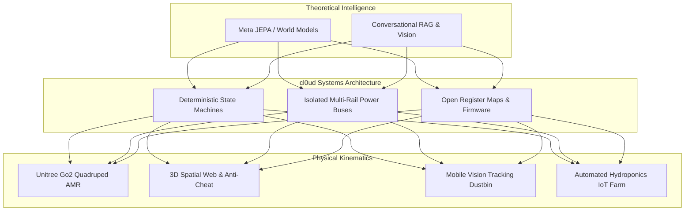

<div align="center">

  

  <br/>

  [](file:///Users/roopalisingh/Desktop/cl0ud/cl0ud-brand-spec.json)
  [](https://github.com/Ojas-sta)
  [](file:///Users/roopalisingh/Desktop/cl0ud/cl0ud-brand-spec.json)
  [](file:///Users/roopalisingh/Desktop/cl0ud/LICENSE)

  <br/>

  <h3>Autonomous Cyber-Physical Systems • Mechatronics Architecture • Ethical Peer Attribution</h3>

  <p align="center">
    <b>cl0ud</b> is the personal engineering brand, research lab, and systems architecture ecosystem founded by <b>Ojas Singh</b>.
  </p>

</div>

---

## 🧭 Table of Contents

- [1. Executive Summary](#1-executive-summary)
- [2. Founder Identity & Ecosystem Roles](#2-founder-identity--ecosystem-roles)
- [3. Supported Engineering Domains](#3-supported-engineering-domains)
- [4. Project Taxonomy & Ecosystem Registry](#4-project-taxonomy--ecosystem-registry)
- [5. Standardized Attribution Framework](#5-standardized-attribution-framework)
- [6. Visual Identity & Brand System](#6-visual-identity--brand-system)
- [7. Repository Directory Structure](#7-repository-directory-structure)
- [8. Governance & Legal Framework](#8-governance--legal-framework)
- [9. Automated Validation Suite](#9-automated-validation-suite)
- [10. Publishing to GitHub](#10-publishing-to-github)

---

## 1. Executive Summary

**cl0ud** (pronounced `/klaʊd/`, stylized with a numeral zero `0`) represents an engineering discipline focused on bridging high-level artificial intelligence with deterministic physical hardware. 

Originating within the Advanced Prototyping and Robotics laboratories of **Delhi Public School Indirapuram (DPSI)**, cl0ud exists to establish an engineering standard of record:



### The Zero `0` Mandate
The numeral zero (`0`) in `cl0ud` is not a decorative gimmick; it signifies:
1. **Binary Determinism:** The baseline computational state (`0` and `1`).
2. **Ground Potential ($0\text{V}$):** The shared electrical reference plane vital to noise rejection and circuit isolation.
3. **Clean Reset:** The philosophical habit of evaluating engineering problems from first principles without preconceptions.

---

## 2. Founder Identity & Ecosystem Roles

| Identity Dimension | Role & Description |
| :--- | :--- |
| **Founder & Lead Architect** | **Ojas Singh** ([`@Ojas-sta`](https://github.com/Ojas-sta) / `ojasctc@gmail.com`). Directs systems architecture, mechatronic design, and specification schemas. |
| **cl0ud Engineering Brand** | The technical standard, open-source firmware umbrella, and badge ecosystem. |
| **Institutional Collaborators** | **DPSI Student Robotics Team** and **Delhi Public School Indirapuram**. Co-engineers and academic hosts for major capstone platforms. |
| **Peer Inventors** | Independent student project authors who retain 100% project ownership while receiving cl0ud technical mentorship. |

> [!IMPORTANT]
> **Zero Ownership Claim Over External Projects:** Receiving technical assistance, CAD reviews, or runtime libraries from cl0ud **never** transfers project ownership to cl0ud. Collaborative projects remain the exclusive property of their respective student creators and institutions.

---

## 3. Supported Engineering Domains

cl0ud provides architectures, schematics, and open-source tooling across six specialized technical disciplines:

1. **Autonomous Mobile Robotics (AMR) & Mechatronics:** Kinematic modeling, custom CNC/PETG guide-rail caddies, isolated buck-regulated power topologies ($24\text{V} \rightarrow 12\text{V}/5\text{V}$), and EKF sensor fusion.
2. **World Models & AI Simulation:** Coupling Meta JEPA (Joint Embedding Predictive Architecture) with closed-form inverse kinematics, optimized for Apple Silicon Metal Performance Shaders (MPS).
3. **Spatial Computing & 3D Web:** High-fidelity architectural WebGL/Three.js 3D virtual floor plans, MediaPipe gesture tracking, and multi-tier anti-cheat voting mechanisms.
4. **Embedded Microcontroller Firmware:** Bare-metal C++, Renesas RA4M1 register programming for the Arduino Uno R4 WiFi, and hardware I2C slave register maps.
5. **Autonomous Service Robotics:** Optical centroid target tracking via OpenCV, differential-drive PID velocity control, and ultrasonic proximity safety rings.
6. **AgriTech & Environmental IoT:** Precision analog pH and EC probe calibration, automated peristaltic dosing pumps, and real-time MQTT telemetry pipelines.

---

## 4. Project Taxonomy & Ecosystem Registry

All active and field-deployed projects are cataloged in [`projects/verified-projects.json`](file:///Users/roopalisingh/Desktop/cl0ud/projects/verified-projects.json):

```
+---------+------------------------------------------+-----------------------+------------------------+
| ID      | Project Name                             | cl0ud Involvement     | Primary Authors        |
+---------+------------------------------------------+-----------------------+------------------------+
| PRJ-001 | Project CLOUD (Unitree Go2 Quadruped)    | Powered by            | DPSI Robotics / Ojas   |
| PRJ-002 | DPSI 3D Exhibition & Live Voting App     | Powered by            | DPSI / Ojas Singh      |
| PRJ-003 | WorldXD JEPA Robotic Arm Simulator       | Created by            | cl0ud (Ojas Singh)     |
| PRJ-004 | DPSI TinkerTek Open-Source Firmware      | Co-engineered by      | DPSI / s4s / Ojas      |
| PRJ-005 | Autonomous Mobile Smart Dustbin          | Technical assistance  | Student Capstone Team  |
| PRJ-006 | Automated Hydroponic Farming IoT Station | Technical assistance  | AgriTech Team          |
| PRJ-007 | Spatial-OS & Vision-Track Environment    | Created by            | cl0ud (Ojas Singh)     |
+---------+------------------------------------------+-----------------------+------------------------+
```

*For comprehensive project monographs, see the [`documentation/engineering-portfolio.md`](file:///Users/roopalisingh/Desktop/cl0ud/documentation/engineering-portfolio.md).*

---

## 5. Standardized Attribution Framework

To prevent misattribution and protect student creators, cl0ud enforces a standardized attribution matrix:

```mermaid
graph TD
    A[Is cl0ud the sole creator?] -->|Yes| B[Formula 1: Created by cl0ud]
    A -->|No| C[Is this a core co-engineered team capstone?]
    C -->|Yes| D[Formula 2: Powered by cl0ud | Co-engineered by Ojas Singh]
    C -->|No| E[Did cl0ud provide advisory assistance or review?]
    E -->|Yes| F[Formula 3: Project by Team | Technical Assistance by cl0ud & Ojas Singh]
    E -->|No| G[Formula 4: Powered by cl0ud]
```

### Official cl0ud Engineering Credit Card Badge
The standardized attribution card for physical plinths, exhibition websites, and documentation footers:

<div align="center">
  
</div>

<br/>

### Ready-to-Use Attribution Snippets
- **Official Credit Card SVG:** [`assets/badges/cl0ud-credit-card.svg`](file:///Users/roopalisingh/Desktop/cl0ud/assets/badges/cl0ud-credit-card.svg)
- **Drop-in Web Component (HTML/CSS):** [`attribution/formats/credit-card-component.html`](file:///Users/roopalisingh/Desktop/cl0ud/attribution/formats/credit-card-component.html)
- **React / Next.js Component:** [`attribution/formats/credit-card-component.jsx`](file:///Users/roopalisingh/Desktop/cl0ud/attribution/formats/credit-card-component.jsx)
- **Vue 3 Component:** [`attribution/formats/credit-card-component.vue`](file:///Users/roopalisingh/Desktop/cl0ud/attribution/formats/credit-card-component.vue)
- **Primary Shield:** `[](https://github.com/Ojas-sta/cl0ud-brand-engineering)`
- **Personal Shield:** `[](https://github.com/Ojas-sta)`
- **Physical Plinth Badge:** See [`assets/badges/exhibition-plinth-badge.svg`](file:///Users/roopalisingh/Desktop/cl0ud/assets/badges/exhibition-plinth-badge.svg).

*Full guidelines and medium-specific rules are documented in [`attribution/guidelines/attribution-rules.md`](file:///Users/roopalisingh/Desktop/cl0ud/attribution/guidelines/attribution-rules.md).*

---

## 6. Visual Identity & Brand System

- **Primary Colors:** Deep Obsidian (`#0B0F19`), Deep Space (`#030712`), Electric Cyan (`#00E5FF`), Aerospace Blue (`#1E3A8A`), Cloud White (`#F8FAFC`).
- **Typography:**
  - *Headings & Display:* **Outfit** / **Space Grotesk**
  - *Body Reading:* **Inter**
  - *Code & Registers:* **JetBrains Mono**
- **Vector Assets:** Available in [`assets/logos/`](file:///Users/roopalisingh/Desktop/cl0ud/assets/logos/) (Primary, Monochrome Dark, Monochrome Light, Outline, and Favicon).

*Full visual design specifications are detailed in [`brand/guidelines/brand-manual.md`](file:///Users/roopalisingh/Desktop/cl0ud/brand/guidelines/brand-manual.md).*

---

## 7. Repository Directory Structure

```text
/Users/roopalisingh/Desktop/cl0ud/
├── README.md                           # Main engineering brand & ecosystem portal
├── LICENSE                             # Dual license (MIT for code, CC BY-NC-ND for brand)
├── CHANGELOG.md                        # Semantic versioning release log
├── CONTRIBUTING.md                     # Engineering collaboration & contribution policy
├── CODE_OF_CONDUCT.md                  # Contributor Covenant standard
├── SECURITY.md                         # Responsible vulnerability disclosure policy
├── .gitignore                          # Node, Python, macOS, build artifacts ignore rules
├── .editorconfig                       # Formatting and indentation standards
├── cl0ud-brand-spec.json               # 10-section comprehensive JSON brand specification
├── schemas/
│   └── cl0ud-brand-spec.schema.json   # JSON Schema Draft 2020-12 strict validator
├── brand/
│   ├── identity/                       # Purpose, mission, vision, founder profile
│   ├── guidelines/                     # Core brand manual and usage boundaries
│   ├── messaging/                      # Voice, tone, elevator pitch, boilerplate
│   ├── typography/                     # Font stacks and typographic scale
│   ├── colors/                         # Hex, HSL, RGB palette tokens and contrast matrix
│   └── logo/                           # Vector construction and clear space rules
├── attribution/
│   ├── formats/                        # Markdown, HTML, ASCII, and badge specifications
│   ├── templates/                      # Ready-to-paste snippets for posters, slides, footers
│   └── guidelines/                     # Mandatory vs. optional attribution rules
├── projects/
│   ├── README.md                       # Project directory guide and taxonomy
│   ├── verified-projects.json          # Machine-readable registry of verified projects
│   └── project-template/               # Starter template for onboarding new projects
├── engineering/
│   ├── architecture/                   # High-level systems design principles
│   ├── standards/                      # Coding standards and Conventional Commits
│   ├── workflows/                      # Hardware prototyping and CI/CD pipelines
│   └── technical-documentation/        # Technical monograph writing standard
├── legal/
│   ├── terms-and-conditions.md         # Comprehensive proposed T&C framework
│   ├── brand-usage-policy.md           # Permitted vs. prohibited brand usage
│   ├── attribution-policy.md           # Mandatory attribution rules
│   ├── intellectual-property.md        # IP rights separation between cl0ud and collaborators
│   └── disclaimers.md                  # Hardware safety notice and liability limitations
├── documentation/
│   ├── brand-overview.md               # Executive ecosystem summary
│   ├── engineering-portfolio.md        # Deep-dive case studies of verified projects
│   ├── collaboration-model.md          # 4-stage collaboration runbook for schools
│   └── faq.md                          # Frequently asked questions
├── assets/
│   ├── logos/                          # Raw and optimized SVG marks and variants
│   ├── badges/                         # Standardized SVG attribution badges
│   └── icons/                          # 32x32 Favicon and app icons
├── templates/
│   ├── project-readme-template.md      # Standard README for cl0ud-engineered projects
│   ├── project-attribution-template.md # Attribution block for collaborative codebases
│   ├── exhibition-credit-template.md   # Physical booth plinth and poster credit specs
│   └── collaboration-template.md       # Engineering intake and IP agreement form
├── examples/
│   ├── exhibition-project/             # Case study: Project CLOUD Quadruped ARGUS/Docent
│   ├── collaborative-project/          # Case study: DPSI 3D App & Smart Dustbin
│   └── personal-project/               # Case study: WorldXD JEPA Simulation Engine
└── tools/
    └── validation/
        └── validate-brand-spec.py      # Automated Python integrity validator
```

---

## 8. Governance & Legal Framework

### Dual-Licensing Architecture
1. **Software Code, Firmware & Tooling:** Licensed under the permissive **[MIT License](file:///Users/roopalisingh/Desktop/cl0ud/LICENSE)**.
2. **Brand Marks & Badges:** Licensed under **[CC BY-NC-ND 4.0](https://creativecommons.org/licenses/by-nc-nd/4.0/)** (protecting the cl0ud name and logo from unauthorized commercial monetization or distortion).
3. **Technical Monographs:** Licensed under **[CC BY 4.0](https://creativecommons.org/licenses/by/4.0/)** for open educational and academic citation.

> [!NOTE]
> **Legal Notice:** The proposed Terms & Conditions and usage policies in [`legal/`](file:///Users/roopalisingh/Desktop/cl0ud/legal/) serve as an architectural baseline for school exhibitions and open-source collaborations and must undergo professional legal review prior to commercial execution.

---

## 9. Automated Validation Suite

The repository includes a dedicated Python validation tool to verify syntax, JSON Schema Draft 2020-12 compliance, contribution level enums, and project registry integrity:

```bash
# Run the automated validation script
python3 tools/validation/validate-brand-spec.py
```

### Sample Output:
```text
==================================================
cl0ud Brand Specification Integrity Validator
Target: .../cl0ud/cl0ud-brand-spec.json
==================================================
[PASS] JSON syntax is valid.
[PASS] All 10 required brand sections are present.
[PASS] All 7 verified projects use standardized contribution levels.
[PASS] JSON Schema Draft 2020-12 validation passed with 0 errors.

SUCCESS: All brand specification integrity checks passed successfully.
```

---

## 10. Publishing to GitHub

To publish this initialized repository to GitHub under account [`Ojas-sta`](https://github.com/Ojas-sta):

```bash
# 1. Verify all files and commit status
git status

# 2. Create the remote repository on GitHub (Public)
gh repo create Ojas-sta/cl0ud-brand-engineering --public --source=. --description "Official engineering brand, mechatronics architecture, and attribution ecosystem for cl0ud (Ojas Singh)"

# 3. Push the main branch to GitHub
git push -u origin main
```

---

<div align="center">
  <p><b>cl0ud Engineering</b> • Founded by <b>Ojas Singh</b> • Delhi Public School Indirapuram</p>
  <p><i>"Engineered with Precision. Attributed with Integrity."</i></p>
</div>
