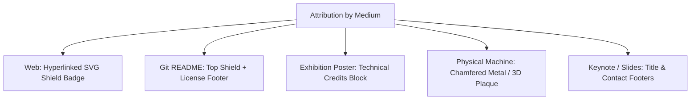

# cl0ud — Attribution Syntax & Formatting Standards

> **System Designation:** Syntax Definitions for Engineering Attributions  
> **Brand Mark:** cl0ud  
> **Specification Reference:** [`cl0ud-brand-spec.json`](file:///Users/roopalisingh/Desktop/cl0ud/cl0ud-brand-spec.json)

---

## 1. Syntax Formulas

### Formula A: Primary Brand Attribution
Used when systems software, runtime architecture, or design foundations are provided by cl0ud.
```text
Powered by cl0ud
```

### Formula B: Individual Engineering Credit
Used when Ojas Singh contributes directly as a team co-developer or lead systems engineer.
```text
Co-engineered by Ojas Singh
```

### Formula C: Combined Systems Architecture & Engineering
The flagship standard for exhibition capstone systems and collaborative repositories.
```text
Powered by cl0ud | Co-engineered by Ojas Singh
```

### Formula D: Peer Technical Mentorship / Advisory Assistance
Used when cl0ud and Ojas Singh provide advisory review, algorithm tuning, or calibration math for independent student projects.
```text
Project by [Team Name] | Technical Assistance by cl0ud & Ojas Singh
```

### Formula E: Multi-Institution Partnership Block
Used for formal institutional exhibitions and academic submissions.
```text
Engineered by [Institution/Club Team]
Systems Architecture: cl0ud (Ojas Singh)
Collaborated with [Host Institution, e.g., DPS Indirapuram]
```

---

## 2. Formatting by Medium



1. **Digital Web:** SVG badge hyperlinked to `https://github.com/Ojas-sta/cl0ud-brand-engineering`.
2. **Git README:** Top ribbon badge + formal Acknowledgments section.
3. **Exhibition Posters:** Bottom metadata footer in high-contrast box ($14\text{pt}$ minimum).
4. **Physical Machines:** Laser-engraved or 3D-printed chassis plinth badge mounted on frame.
5. **Keynote Slides:** Monospace footnote on title slide and closing Q&A slide.
