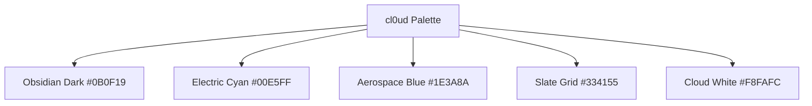

# cl0ud — Color Palette & Contrast Matrix

> **System Designation:** Visual Design System — Color Tokens  
> **Color Model:** Hex / sRGB / Display P3 / HSL  
> **Compliance Target:** WCAG 2.2 Level AAA (Contrast $\ge 7:1$ for body, $\ge 4.5:1$ for large text)  
> **Specification Reference:** [`cl0ud-brand-spec.json`](file:///Users/roopalisingh/Desktop/cl0ud/cl0ud-brand-spec.json)

---

## 1. Palette Overview

The cl0ud color architecture is built upon a **high-contrast dark aerospace palette**, accented with **luminescent electric cyan** and grounded with **deep obsidian shields**.



---

## 2. Token Specifications

### Primary & Background Tokens
| Token Name | Hex Code | HSL Value | RGB Value | Purpose |
| :--- | :--- | :--- | :--- | :--- |
| **`color-obsidian-dark`** | `#0B0F19` | `222°, 39%, 7%` | `11, 15, 25` | Primary application canvas, badge background |
| **`color-deep-space`** | `#030712` | `220°, 60%, 4%` | `3, 7, 18` | Base dark viewport background, terminal body |
| **`color-alabaster-card`**| `#0F172A` | `222°, 47%, 11%` | `15, 23, 42` | Elevated cards, component containers |

### Accent & Highlight Tokens
| Token Name | Hex Code | HSL Value | RGB Value | Purpose |
| :--- | :--- | :--- | :--- | :--- |
| **`color-electric-cyan`** | `#00E5FF` | `186°, 100%, 50%`| `0, 229, 255` | Primary brand accent, zero glyph, interactive focus |
| **`color-aerospace-blue`**| `#1E3A8A` | `224°, 64%, 33%` | `30, 58, 138` | Secondary badges, telemetry flow lines |
| **`color-signal-amber`** | `#F59E0B` | `38°, 92%, 50%` | `245, 158, 11` | Telemetry warnings, mechanical attention |
| **`color-hyper-violet`** | `#8B5CF6` | `258°, 90%, 66%` | `139, 92, 246` | Spatial computing & AI world model accents |

### Neutral & Typography Tokens
| Token Name | Hex Code | HSL Value | RGB Value | Purpose |
| :--- | :--- | :--- | :--- | :--- |
| **`color-cloud-white`** | `#F8FAFC` | `210°, 40%, 98%` | `248, 250, 252`| Primary headings, high-contrast text |
| **`color-charcoal-muted`**| `#94A3B8` | `215°, 20%, 65%` | `148, 163, 184`| Body text, secondary metrics, subtitles |
| **`color-slate-grid`** | `#334155` | `215°, 25%, 27%` | `51, 65, 85` | Structural borders, schematic grid lines |

---

## 3. Contrast & Accessibility Matrix

All visual applications must satisfy WCAG 2.2 accessibility thresholds:

| Text Token | Background Token | Calculated Contrast Ratio | Compliance Level |
| :--- | :--- | :--- | :--- |
| **Cloud White (`#F8FAFC`)** | Obsidian Dark (`#0B0F19`) | **$18.4 : 1$** | **WCAG AAA Pass** |
| **Electric Cyan (`#00E5FF`)** | Obsidian Dark (`#0B0F19`) | **$14.2 : 1$** | **WCAG AAA Pass** |
| **Charcoal Muted (`#94A3B8`)**| Obsidian Dark (`#0B0F19`) | **$7.8 : 1$** | **WCAG AAA Pass** |
| **Obsidian Dark (`#0B0F19`)** | Electric Cyan (`#00E5FF`) | **$14.2 : 1$** | **WCAG AAA Pass (Badge invert)** |
| **Obsidian Dark (`#0F172A`)** | Cloud White (`#FFFFFF`) | **$16.8 : 1$** | **WCAG AAA Pass (Monochrome)** |

---

## 4. CSS Custom Properties Definition

```css
:root {
  /* cl0ud Core Color Tokens */
  --cl0ud-bg-obsidian: #0b0f19;
  --cl0ud-bg-deep-space: #030712;
  --cl0ud-bg-card: #0f172a;
  
  --cl0ud-accent-cyan: #00e5ff;
  --cl0ud-accent-blue: #1e3a8a;
  --cl0ud-accent-amber: #f59e0b;
  --cl0ud-accent-violet: #8b5cf6;

  --cl0ud-text-white: #f8fafc;
  --cl0ud-text-muted: #94a3b8;
  --cl0ud-border-slate: #334155;

  /* Card and Frosting Surfaces */
  --cl0ud-surface-frost: rgba(255, 255, 255, 0.04);
  --cl0ud-hairline-border: 1px solid rgba(255, 255, 255, 0.08);
  --cl0ud-glow-cyan: 0 0 24px -4px rgba(0, 229, 255, 0.35);
}
```
