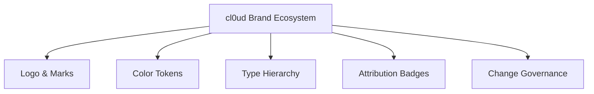

# cl0ud — Engineering Brand Manual

> **Document Type:** Brand Guidelines & Governance Manual  
> **Brand Mark:** cl0ud (`assets/logos/cl0ud-primary.svg`)  
> **Target Audience:** Engineering Collaborators, Exhibition Committees, Student Developers  
> **Specification Reference:** [`cl0ud-brand-spec.json`](file:///Users/roopalisingh/Desktop/cl0ud/cl0ud-brand-spec.json)

---

## 1. Brand Ecosystem Overview

The **cl0ud** brand represents a commitment to high-standard systems engineering, rigorous mechatronics, and honest technical collaboration. These guidelines define the visual, verbal, and architectural standards that must be maintained whenever the cl0ud name, mark, or badges are utilized.



---

## 2. The Core Mark & Components

The cl0ud identity consists of three primary assets:
1. **The Cloud Symbol:** A geometric cloud contour featuring discrete hardware node pins and an internal binary zero (`0`) core with a signal spark.
2. **The Wordmark:** The stylized typography `cl0ud` paired with the mono suffix `.ENGINEERING` or `.ENG`.
3. **The Combined Mark:** The lockup of the cloud symbol and wordmark inside an Obsidian container shield.

```
       ┌────────────────────────────────────────────────────────┐
       │   [ CLOUD SYMBOL ]      cl0ud .ENGINEERING             │
       │     (Zero Core)                                        │
       └────────────────────────────────────────────────────────┘
```

---

## 3. Brand Architecture & Variants

| Mark Variant | Asset Location | Intended Application |
| :--- | :--- | :--- |
| **Primary Full Color** | [`assets/logos/cl0ud-primary.svg`](file:///Users/roopalisingh/Desktop/cl0ud/assets/logos/cl0ud-primary.svg) | Digital headers, exhibition slides, web applications |
| **Standalone Icon** | [`assets/logos/cl0ud-icon.svg`](file:///Users/roopalisingh/Desktop/cl0ud/assets/logos/cl0ud-icon.svg) | App icons, robot chassis decals, avatars |
| **Wordmark Only** | [`assets/logos/cl0ud-wordmark.svg`](file:///Users/roopalisingh/Desktop/cl0ud/assets/logos/cl0ud-wordmark.svg) | Inline document headings, code banners |
| **Monochrome Dark** | [`assets/logos/cl0ud-monochrome-dark.svg`](file:///Users/roopalisingh/Desktop/cl0ud/assets/logos/cl0ud-monochrome-dark.svg) | White paper print, laser engraving on light surfaces |
| **Monochrome Light** | [`assets/logos/cl0ud-monochrome-light.svg`](file:///Users/roopalisingh/Desktop/cl0ud/assets/logos/cl0ud-monochrome-light.svg) | Laser engraving on black anodized aluminum, dark decals |
| **Outline Wireframe** | [`assets/logos/cl0ud-outline.svg`](file:///Users/roopalisingh/Desktop/cl0ud/assets/logos/cl0ud-outline.svg) | CAD schematics, PCB silkscreen layers |
| **Favicon** | [`assets/icons/favicon.svg`](file:///Users/roopalisingh/Desktop/cl0ud/assets/icons/favicon.svg) | Web browser tabs, embedded documentation portals |

---

## 4. Clear Space & Minimum Sizing

### Clear Space Rule
To preserve optical impact, maintain a clear space border around all sides of the mark equal to the height of the letter **`c`** ($1.0X$).
- Minimum digital margin: **24px**
- Minimum print margin: **5mm**

No other graphic element, border line, or text may intrude into this zone.

### Minimum Sizes
- **Digital Display:** 
  - Wordmark height: $\ge 32\text{px}$
  - Standalone symbol: $\ge 20\text{px}$
  - Favicon: $16\text{px} \times 16\text{px}$ (using the simplified icon)
- **Physical Print & Fabrication:**
  - Plinth plaque height: $\ge 20\text{mm}$
  - Poster badge height: $\ge 12\text{mm}$
  - Chassis sticker width: $\ge 40\text{mm}$

---

## 5. Background Restrictions

| Allowed Surfaces | Prohibited Surfaces |
| :--- | :--- |
| **Deep Obsidian (`#0B0F19`)** or dark gray surfaces | Low-contrast neon cyan or electric blue backgrounds |
| **Cloud White (`#F8FAFC`)** (using Monochrome Dark) | Cluttered, unmasked hardware photos without a backing shield |
| **Frosted Glass Cards (`rgba(255,255,255,0.04)`)** | Saturated warm tones (bright yellow, hot pink, vivid red) |
| **Brushed Metal & Anodized Aluminum** | Distorted aspect ratios or stretched bounding boxes |

---

## 6. Prohibited Practices (Logo Misuse)

1. **Never substitute the letter 'o' for the number '0'.** The identity is strictly `cl0ud`.
2. **Never apply unapproved drop shadows.** Soft blurred outer glows degrade the architectural precision of the vector paths.
3. **Never rotate the mark at arbitrary angles.** The logo must be placed horizontally ($0^\circ$).
4. **Never alter individual element colors.** Do not change the zero glyph to colors outside Electric Cyan (`#00E5FF`) or authorized monochrome tones.

---

## 7. Compliance Checklist

Before publishing any poster, slide deck, repository, or chassis badge:
- [ ] Has the official SVG asset been sourced directly from `assets/logos/`?
- [ ] Is the clear space of $1.0X$ respected on all four sides?
- [ ] Does the background meet contrast requirements ($\ge 4.5:1$)?
- [ ] Is the spelling strictly `cl0ud` with a numeral zero?
- [ ] Has the correct attribution badge formula been selected from [`attribution-rules.md`](file:///Users/roopalisingh/Desktop/cl0ud/attribution/guidelines/attribution-rules.md)?
