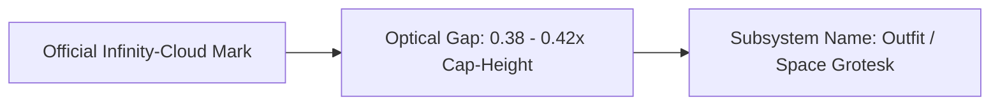

# cl0ud — Subsystem Lockup & Typography Guidelines

> **System Designation:** Subsystem Product Branding & Typographic Lockup  
> **Brand Lockup Paradigm:** `[cl0ud Logo]` + `[Subsystem Name]` (Apple-style inline glyph lockup)  
> **Reference Model:** `Card` / `Pay` Style Architecture  
> **Vector Asset:** [`assets/logos/cl0ud-lockup-system.svg`](file:///Users/roopalisingh/Desktop/cl0ud/assets/logos/cl0ud-lockup-system.svg)  
> **Specification Reference:** [`cl0ud-brand-spec.json`](file:///Users/roopalisingh/Desktop/cl0ud/cl0ud-brand-spec.json)

---

## 1. The Lockup Anatomy

In the cl0ud product ecosystem, services, hardware layers, and software products are branded by pairing the **Infinity-Cloud symbol** directly with the subsystem name:

```
[☁] Bedrock    [☁] Vertex    [☁] Borg    [☁] Breadcrumbs    [☁] Artifact
```



### Optical Metrics & Spacing Formula

| Metric Parameter | Value / Formula | Description |
| :--- | :--- | :--- |
| **Cap-Height ($H$)** | Baseline reference | Height of capital letter (e.g., 'B' in Bedrock). |
| **Symbol Height ($H_s$)** | $1.05 \times H$ | Symbol is scaled slightly larger than cap-height to compensate for circular curvature. |
| **Symbol Width ($W_s$)** | $1.49 \times H_s$ | Preserves the native $608 : 408$ aspect ratio of the official infinity-cloud. |
| **Horizontal Gap ($G$)** | $0.38 \text{ to } 0.42 \times H$ | Optical whitespace between the cloud symbol's rightmost edge and the text. |
| **Baseline Alignment** | Exact $0\text{px}$ offset | The flat base stroke of the cloud anchors on the typographic baseline. |
| **Tracking / Kerning** | `-0.02em` | Tight geometric letter-spacing matching high-end hardware interfaces. |

---

## 2. Typographic Options

### Primary Display Typeface: `Outfit`
- **Weights:** Semi-Bold (`600`) for standard product locks; Bold (`700`) for hero banners.
- **Why Outfit:** Clean geometric circular counters that resonate with the curves of the infinity-cloud mark.

### Secondary Architectural Typeface: `Space Grotesk`
- **Weights:** Bold (`700`).
- **Why Space Grotesk:** Technical, monospace-influenced flavor ideal for low-level systems (e.g. `☁ Borg`, `☁ Anthos`, `☁ Bigtable`).

---

## 3. Surface & Color Finish Variants

### Style 1: Prismatic Titanium Gradient (Apple Card Style)
Inspired by the iridescent finish of Apple Card (as seen in `assets/reference/apple-card-naming-reference.png`):
- **Gradient Vector:**
  - $0\%$: `#C084FC` (Hyper Violet)
  - $25\%$: `#F472B6` (Pink Accent)
  - $50\%$: `#FB923C` (Warm Titanium Gold)
  - $75\%$: `#FACC15` (Signal Amber)
  - $100\%$: `#38BDF8` (Sky Blue)
- **Application:** Master keynotes, flagship exhibition placards, and primary website hero sections.

### Style 2: Cybernetic Contrast (Electric Cyan + Cloud White)
- **Symbol:** Electric Cyan gradient (`#00E5FF` to `#38BDF8`).
- **Subsystem Name:** Crisp Cloud White (`#F8FAFC`).
- **Background:** Deep Obsidian (`#0B0F19`) or pitch black (`#000000`).
- **Application:** Dark-mode web interfaces, terminal status bars, and UI navigation drawers.

### Style 3: Minimal Monochrome
- **Symbol & Text:** Pure White (`#FFFFFF`) on dark surfaces, or Obsidian (`#0F172A`) on light surfaces.
- **Application:** Laser-engraved CNC aluminum chassis, silkscreened PCBs, and white-paper academic monographs.

---

## 4. Reusable Web & CSS Implementation

```html
<!-- Reusable Apple-Style Subsystem Lockup -->
<span class="cl0ud-lockup">
  <svg class="cl0ud-lockup-icon" viewBox="0 0 608 408" fill="none" xmlns="http://www.w3.org/2000/svg">
    <path fill="currentColor" fill-rule="evenodd" d="M 309.8 1.5 c -23.8 3.0 -45.7 11.0 -65.4 23.8 -16.7 10.8 -31.5 24.8 -42.8 40.3 l -5.5 7.6 -5.1 -1.4 c -7.4 -2.1 -26.8 -2.8 -36.7 -1.3 -39.4 5.7 -70.9 32.3 -83.0 70.0 l -2.7 8.5 -8.8 6.2 c -38.8 27.0 -59.7 66.9 -59.7 113.8 -0.1 22.0 4.3 40.6 14.2 61.0 6.8 14.0 15.6 25.8 28.0 37.8 19.9 19.2 41.2 30.5 68.4 36.4 6.9 1.5 13.4 1.8 40.7 1.8 35.1 -0.0 39.2 -0.4 55.4 -5.7 34.2 -11.0 63.0 -34.9 96.1 -79.7 37.2 -50.3 44.9 -60.4 55.3 -72.2 22.3 -25.5 45.9 -42.4 72.3 -51.7 11.5 -4.1 22.8 -5.6 35.3 -4.9 11.9 0.7 19.5 2.6 29.1 7.2 19.6 9.5 33.7 26.4 40.7 48.5 2.0 6.4 2.3 9.5 2.3 21.5 -0.1 13.2 -0.3 14.5 -3.5 23.9 -7.1 20.9 -21.6 37.0 -41.5 46.2 -14.9 6.9 -13.3 6.7 -83.5 7.2 l -63.5 0.4 -13.5 18.0 c -7.4 9.9 -18.2 23.4 -23.8 30.0 l -10.4 11.9 90.9 -0.4 c 89.0 -0.3 91.0 -0.4 99.3 -2.5 19.3 -4.8 31.9 -10.5 49.1 -22.0 47.4 -31.7 69.8 -91.1 55.6 -147.2 -12.3 -48.2 -49.8 -85.9 -98.0 -98.4 l -9.0 -2.4 -2.3 -9.8 c -2.9 -12.7 -7.1 -24.0 -13.9 -37.3 -22.0 -42.6 -62.3 -73.3 -109.0 -83.1 -11.5 -2.4 -39.4 -3.5 -51.1 -2.0 z m 39.2 60.4 c 29.0 6.2 55.4 26.2 68.1 51.9 4.8 9.7 9.7 23.8 8.6 24.7 -0.5 0.3 -3.3 1.4 -6.3 2.5 -28.5 9.6 -52.0 25.4 -80.5 53.9 -19.7 19.8 -28.6 30.4 -57.0 68.1 -22.1 29.4 -29.2 38.0 -41.2 49.6 -20.2 19.6 -39.7 29.9 -62.9 33.0 -5.7 0.7 -16.9 1.0 -31.9 0.6 -19.6 -0.4 -24.1 -0.8 -30.5 -2.6 -45.2 -13.1 -68.8 -61.6 -51.0 -104.5 9.5 -22.8 26.7 -37.9 51.2 -45.0 l 8.3 -2.4 0.6 -12.8 c 0.6 -15.4 2.9 -23.2 9.1 -31.5 7.6 -10.2 19.2 -16.8 32.3 -18.4 7.2 -0.8 7.8 -0.1 6.4 7.1 -0.8 4.1 -1.3 29.3 -1.6 82.2 l -0.4 76.4 3.3 -0.7 c 16.0 -3.5 33.6 -17.1 49.7 -38.7 l 7.2 -9.8 -0.7 -42.2 c -0.4 -28.7 -0.3 -45.4 0.5 -51.9 3.2 -28.0 16.3 -52.6 37.0 -69.1 13.7 -11.0 32.0 -19.2 48.6 -21.8 7.8 -1.2 24.2 -0.5 33.1 1.4 z" />
  </svg>
  <span class="cl0ud-lockup-text">Bedrock</span>
</span>

<style>
.cl0ud-lockup {
  display: inline-flex;
  align-items: baseline;
  font-family: 'Outfit', -apple-system, BlinkMacSystemFont, sans-serif;
  font-size: 32px;
  font-weight: 600;
  letter-spacing: -0.02em;
  color: #f8fafc;
}

.cl0ud-lockup-icon {
  height: 0.82em; /* Exactly 1.05x cap-height of Outfit */
  width: auto;
  margin-right: 0.38em; /* Optical spacing matching Apple Card */
  vertical-align: -0.06em; /* Aligns flat base of cloud with text baseline */
  color: #00e5ff; /* Electric cyan accent */
}
</style>
```

---

## 5. Hierarchical / Nested Subsystem Lockup Specifications ("Subsystems Inside Subsystems")

When branding complex mechatronic or distributed systems where projects contain multiple subsystems and subsystems contain nested sub-subsystems, the cl0ud design system enforces the **Hierarchical Lockup Standard**.

### A. Style 1: Inline Breadcrumb Lockup (Standard)

```
[☁] Access • Latch         [☁] Binzo • Holonomic         [☁] Expo • Hall
```

```html
<span class="cl0ud-hierarchical-lockup">
  <svg class="cl0ud-lockup-icon" viewBox="0 0 608 408" fill="none">
    <path fill="currentColor" fill-rule="evenodd" d="M 309.8 1.5 c -23.8 3.0 -45.7 11.0 -65.4 23.8 -16.7 10.8 -31.5 24.8 -42.8 40.3 l -5.5 7.6 -5.1 -1.4 c -7.4 -2.1 -26.8 -2.8 -36.7 -1.3 -39.4 5.7 -70.9 32.3 -83.0 70.0 l -2.7 8.5 -8.8 6.2 c -38.8 27.0 -59.7 66.9 -59.7 113.8 -0.1 22.0 4.3 40.6 14.2 61.0 6.8 14.0 15.6 25.8 28.0 37.8 19.9 19.2 41.2 30.5 68.4 36.4 6.9 1.5 13.4 1.8 40.7 1.8 35.1 -0.0 39.2 -0.4 55.4 -5.7 34.2 -11.0 63.0 -34.9 96.1 -79.7 37.2 -50.3 44.9 -60.4 55.3 -72.2 22.3 -25.5 45.9 -42.4 72.3 -51.7 11.5 -4.1 22.8 -5.6 35.3 -4.9 11.9 0.7 19.5 2.6 29.1 7.2 19.6 9.5 33.7 26.4 40.7 48.5 2.0 6.4 2.3 9.5 2.3 21.5 -0.1 13.2 -0.3 14.5 -3.5 23.9 -7.1 20.9 -21.6 37.0 -41.5 46.2 -14.9 6.9 -13.3 6.7 -83.5 7.2 l -63.5 0.4 -13.5 18.0 c -7.4 9.9 -18.2 23.4 -23.8 30.0 l -10.4 11.9 90.9 -0.4 c 89.0 -0.3 91.0 -0.4 99.3 -2.5 19.3 -4.8 31.9 -10.5 49.1 -22.0 47.4 -31.7 69.8 -91.1 55.6 -147.2 -12.3 -48.2 -49.8 -85.9 -98.0 -98.4 l -9.0 -2.4 -2.3 -9.8 c -2.9 -12.7 -7.1 -24.0 -13.9 -37.3 -22.0 -42.6 -62.3 -73.3 -109.0 -83.1 -11.5 -2.4 -39.4 -3.5 -51.1 -2.0 z m 39.2 60.4 c 29.0 6.2 55.4 26.2 68.1 51.9 4.8 9.7 9.7 23.8 8.6 24.7 -0.5 0.3 -3.3 1.4 -6.3 2.5 -28.5 9.6 -52.0 25.4 -80.5 53.9 -19.7 19.8 -28.6 30.4 -57.0 68.1 -22.1 29.4 -29.2 38.0 -41.2 49.6 -20.2 19.6 -39.7 29.9 -62.9 33.0 -5.7 0.7 -16.9 1.0 -31.9 0.6 -19.6 -0.4 -24.1 -0.8 -30.5 -2.6 -45.2 -13.1 -68.8 -61.6 -51.0 -104.5 9.5 -22.8 26.7 -37.9 51.2 -45.0 l 8.3 -2.4 0.6 -12.8 c 0.6 -15.4 2.9 -23.2 9.1 -31.5 7.6 -10.2 19.2 -16.8 32.3 -18.4 7.2 -0.8 7.8 -0.1 6.4 7.1 -0.8 4.1 -1.3 29.3 -1.6 82.2 l -0.4 76.4 3.3 -0.7 c 16.0 -3.5 33.6 -17.1 49.7 -38.7 l 7.2 -9.8 -0.7 -42.2 c -0.4 -28.7 -0.3 -45.4 0.5 -51.9 3.2 -28.0 16.3 -52.6 37.0 -69.1 13.7 -11.0 32.0 -19.2 48.6 -21.8 7.8 -1.2 24.2 -0.5 33.1 1.4 z" />
  </svg>
  <span class="cl0ud-parent-subsystem">Access</span>
  <span class="cl0ud-breadcrumb-sep">•</span>
  <span class="cl0ud-child-subsystem">Latch</span>
</span>

<style>
.cl0ud-hierarchical-lockup {
  display: inline-flex;
  align-items: baseline;
  font-family: 'Outfit', -apple-system, BlinkMacSystemFont, sans-serif;
  font-size: 28px;
  letter-spacing: -0.02em;
}

.cl0ud-hierarchical-lockup .cl0ud-lockup-icon {
  height: 0.82em;
  width: auto;
  margin-right: 0.38em;
  vertical-align: -0.06em;
  color: #00e5ff;
}

.cl0ud-parent-subsystem {
  font-weight: 600;
  color: #f8fafc;
}

.cl0ud-breadcrumb-sep {
  font-weight: 700;
  color: #00e5ff;
  margin: 0 0.35em;
  user-select: none;
}

.cl0ud-child-subsystem {
  font-weight: 500;
  color: #94a3b8;
}
</style>
```

### B. Style 2: Hardware Monograph / CLI Tag Style

For terminal consoles, schematic pinout overlays, and embedded debug logs:

```
[cl0ud::Access.Latch]     GPIO 18 | 50Hz LEDC PWM | 0° <-> 90°
[cl0ud::Binzo.Holonomic]  I2C 0x24 | 4WD Mecanum Vector | 100Hz
[cl0ud::Expo.Ballot]      ThumbmarkJS Canvas Entropy | SHA-256 Salt
```

### C. Style 3: Stacked Micro-Badge Lockup

For exhibition placards, 3D plinth labels, and PCB silkscreen legends:

```
+------------------------------------+
|  [☁] Access                        |
|      ↳ Latch (50Hz PWM Actuator)   |
|      ↳ OTP   (Crypto Generator)    |
|      ↳ Portal(Offline SoftAP)      |
+------------------------------------+
```

