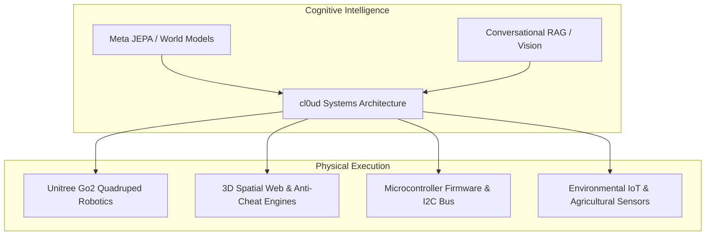

# cl0ud — Brand Purpose, Mission & Vision

> **System Designation:** Brand & Ecosystem Manifesto  
> **Brand Name:** cl0ud (Pronounced `/klaʊd/`, stylized with numerical zero `0`)  
> **Lead Systems Architect:** Ojas Singh ([`@Ojas-sta`](https://github.com/Ojas-sta))  
> **Repository Context:** [`cl0ud-brand-spec.json`](file:///Users/roopalisingh/Desktop/cl0ud/cl0ud-brand-spec.json)

---

## 1. Executive Summary

**cl0ud** is a specialized engineering brand, research umbrella, and systems architecture ecosystem founded by **Ojas Singh**. 

cl0ud represents the technical discipline of bridging high-level computational intelligence (world models, spatial computing, agentic operating systems, conversational RAG) with physical, low-level cyber-physical systems (quadruped robot kinematics, isolated multi-rail power distribution, bare-metal microcontrollers, and IoT sensor telemetry).

cl0ud is **not** an agency or a generic tech label. It functions as an **engineering standard of record** ensuring that complex hardware, robotics prototypes, and software platforms are built with deterministic craftsmanship and attributed with absolute integrity.

---

## 2. Brand Purpose

To demystify and conquer the interface between abstract software algorithms and tangible, real-world machines through rigorous open engineering, reproducible documentation, and ethical peer collaboration.

### The Genesis of cl0ud
In modern student, makerspace, and hackathon culture, engineering frequently succumbs to **"turnkey slop"**—fragile software wrappers, off-the-shelf kits assembled without understanding the underlying physics, and borrowed code presented without proper credit.

cl0ud was formed as an antidote:
- Every circuit is traced to its power rails and back-EMF suppression diodes.
- Every robot payload has structural FEA analysis and vibration dampening.
- Every line of code from upstream open-source communities is explicitly honored.

---

## 3. Mission & Vision

### Mission Statement
> *"To deliver reproducible, deterministic, and beautifully documented engineering systems—spanning quadruped robotics, world-model simulations, IoT automation, and spatial web platforms—while empowering student and peer engineering teams through modular technical assistance."*

### Vision Statement
> *"A global open engineering ecosystem where complex hardware, autonomous agents, and mechatronics are documented with industrial clarity, attributed with integrity, and built with craftsmanship."*

---

## 4. Core Brand Values

### I. Zero Turnkey Slop
We reject black-box shortcuts and fragile superficial demonstrations. If a robot walks, we understand the 12-DOF inverse kinematics and motor torque curves. If an exhibition web application runs, it uses custom anti-cheat entropy checks and optimized WebGL draw calls.

### II. Uncompromising Attribution
Branding must never be used to monopolize or erase peer contributions. When cl0ud collaborates with school peers, makerspace colleagues, or faculty advisors, every participant’s role is made transparent. cl0ud claims only what cl0ud builds or co-engineers.

### III. Hardware-First Determinism
Software intelligence must respect physical laws. Safe power distribution, thermal envelopes, EMI shielding, and emergency mechanical cutoffs take precedence over software enthusiasm.

### IV. Documentation as Architecture
Documentation is not an afterthought; it is the core blueprint. A machine without a clear monograph, register map, or wiring topology is an incomplete prototype.

---

## 5. The Meaning of the Zero `0`

The name **cl0ud** incorporates the numeral zero (`0`) rather than the letter `o`. This typographic distinction represents:
1. **Binary Determinism:** The baseline state of computing (`0` and `1`).
2. **Ground Potential:** The electrical reference plane ($0\text{V}$) essential to signal integrity and noise elimination.
3. **Clean Reset:** The philosophical discipline of evaluating problems from first principles without preconceptions.

When writing or rendering the brand name in text, always write `cl0ud` (lowercase) or `CL0UD` (uppercase). Never substitute a standard lowercase `o` except in project designations like *Project CLOUD*.

---

## 6. Associated Documentation Links
- [`founder-profile.md`](file:///Users/roopalisingh/Desktop/cl0ud/brand/identity/founder-profile.md)
- [`brand-manual.md`](file:///Users/roopalisingh/Desktop/cl0ud/brand/guidelines/brand-manual.md)
- [`attribution-rules.md`](file:///Users/roopalisingh/Desktop/cl0ud/attribution/guidelines/attribution-rules.md)
- [`cl0ud-brand-spec.json`](file:///Users/roopalisingh/Desktop/cl0ud/cl0ud-brand-spec.json)
