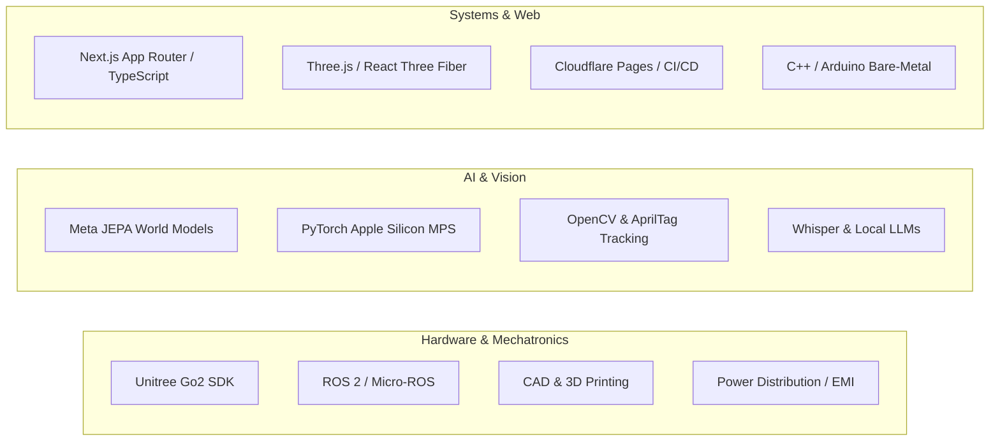

# Ojas Singh — Founder & Systems Architect Profile

> **Identity:** Founder of cl0ud & Lead Systems Architect  
> **Affiliations:** DPS Indirapuram (DPSI) Robotics & Makerspace Engineering  
> **GitHub:** [`@Ojas-sta`](https://github.com/Ojas-sta)  
> **Contact:** `ojasctc@gmail.com`  
> **Ecosystem Specification:** [`cl0ud-brand-spec.json`](file:///Users/roopalisingh/Desktop/cl0ud/cl0ud-brand-spec.json)

---

## 1. Engineering Identity

**Ojas Singh** is an emerging systems architect, robotics engineer, and cyber-physical systems builder. Operating at the intersection of autonomous robotics, world-model artificial intelligence, and spatial computing, Ojas leads the architecture of complex hardware-software platforms and provides modular technical mentorship to student innovation initiatives.

Within the cl0ud ecosystem, Ojas serves as the **brand administrator and principal engineer**, establishing the technical standards, schematics, and attribution frameworks governing all cl0ud-associated initiatives.

---

## 2. Verified Technical Portfolio Highlights

The following projects represent verified, demonstrable engineering deliverables authored or co-engineered by Ojas Singh:

### 1. Project CLOUD (ARGUS & The Docent) — Unitree Go2 Quadruped
- **Role:** Lead Systems Architect & Mechatronics Engineer (in collaboration with the DPSI Student Robotics Team).
- **Core Work:** 
  - Designed the back-load guide rail structural interface with silicone vibration dampening.
  - Fabricated custom rapid-prototyped dual-bay utility caddy for makerspace tool ferrying.
  - Engineered isolated multi-rail step-down electrical topology ($24\text{V} \rightarrow 12\text{V} / 5\text{V}$) with back-EMF suppression.
  - Developed dual cognitive personas: `ARGUS` (AprilTag inventory inspection and liquid spill detection) and `THE DOCENT` (conversational VIP tour narration using local RAG, Whisper, and Piper TTS).
- **Monograph:** Document Revision 5.0.0 Master Technical & Architectural Monograph.

### 2. DPSI Tech & Innovation Exhibition 3D Web Platform
- **Role:** Lead Web Architect & 3D Graphics Engineer.
- **Core Work:**
  - Built photorealistic architectural 3D virtual floor plan using React Three Fiber, Three.js, and Next.js App Router.
  - Engineered a 4-layer anti-cheat live voting engine (client fingerprinting, IP entropy rate limits, honeypot inputs, cryptographic session tokens).
  - Configured automated GitHub Actions CI/CD pipeline deploying static builds to Cloudflare Pages.

### 3. WorldXD Robotic Arm World Model Simulation Platform
- **Role:** Creator & Sole Author.
- **Core Work:**
  - Built an Apple Silicon-native (Metal Performance Shaders / MPS) robotics simulation engine coupling Meta's Joint Embedding Predictive Architecture (JEPA-WMS) with analytical inverse kinematics.
  - Enables visual trajectory planning in latent feature space rather than pixel space.

### 4. DPSI TinkerTek Open-Source Robotics Firmware
- **Role:** Lead Firmware Architect.
- **Core Work:**
  - Designed I2C register maps, bare-metal C++ drivers, and an Agentic OS runtime for School For Schools (s4s) ICRobot, ICBricks, and Arduino Uno R4 WiFi.

### 5. Technical Assistance & Peer Mentorship Projects
- **Autonomous Mobile Smart Dustbin:** Advising student creators on optical target tracking via OpenCV, differential drive kinematics, and ultrasonic sensor filtering.
- **Automated Hydroponics IoT System:** Advising agriculture team on analog pH/EC probe calibration, MQTT telemetry bridges, and automated peristaltic pump dosing logic.

---

## 3. Skills Matrix

---

## 4. Attribution & Presentation Rules

When referencing Ojas Singh in publications, exhibitions, or digital repositories:

1. **Do Not Inflate Credentials:** Ojas should be credited by verified roles: *Lead Systems Architect*, *Robotics Engineer*, or *Co-Engineer*.
2. **Respect Collaborative Attribution:**
   - On team robotics projects: `"Engineered by DPSI Student Robotics Team | Systems Architecture powered by cl0ud | Co-engineered by Ojas Singh"`
   - On peer projects receiving mentorship: `"Project by [Team Name] | Technical Assistance by cl0ud & Ojas Singh"`
3. **Contact & Social Verification:**
   - GitHub: [`https://github.com/Ojas-sta`](https://github.com/Ojas-sta)
   - Email: `ojasctc@gmail.com`
   - Portfolio Showcase: [`https://ojas-sta.github.io/Cloud_DPSI-EXPO26/`](https://ojas-sta.github.io/Cloud_DPSI-EXPO26/)
