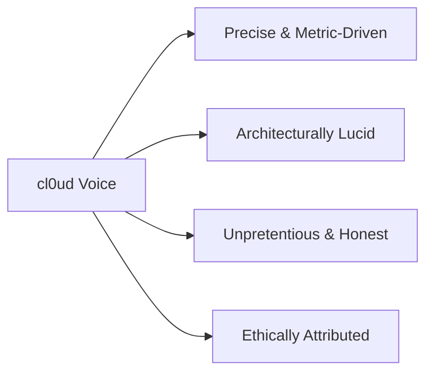

# cl0ud — Brand Voice, Tone & Messaging

> **Document Type:** Verbal Identity & Copywriting Standards  
> **Brand Identity:** cl0ud  
> **Founder:** Ojas Singh  
> **Specification Reference:** [`cl0ud-brand-spec.json`](file:///Users/roopalisingh/Desktop/cl0ud/cl0ud-brand-spec.json)

---

## 1. Verbal Identity Principles

The cl0ud brand voice is that of an **experienced systems engineer speaking to technical peers**: confident, exact, scientifically grounded, and respectful of physical realities.

### Key Voice Attributes
1. **Precise & Metric-Driven:** We state torque in $\text{N}\cdot\text{m}$, speed in $\text{m/s}$, latency in $\text{ms}$, and wire gauges in $\text{AWG}$. We avoid vague adjectives like "super fast" or "ultra powerful."
2. **Architecturally Lucid:** We explain how subsystems connect—data buses, power domains, state machines, and protocols.
3. **Unpretentious & Honest:** We acknowledge real-world engineering constraints: battery limits, sensor noise, latency jitter, and hardware tolerances.
4. **Ethically Attributed:** We highlight collaborators, school teams, open-source communities, and faculty advisors with equal prominence.

---

## 2. The Do's & Don'ts of cl0ud Copy

| What to Do | What to Avoid |
| :--- | :--- |
| **"Engineered with a 24V-to-5V isolated buck regulator to prevent microcontroller brownouts during quadruped motor surges."** | "Has an awesome power system that makes it run super smoothly!" |
| **"Simulated using PyTorch MPS on Apple Silicon, coupling JEPA latent feature loss with closed-form inverse kinematics."** | "Cutting-edge futuristic AI brain that controls robot arms magically." |
| **"Co-engineered by Ojas Singh in collaboration with the DPSI Student Robotics Team."** | "Built exclusively by cl0ud." |
| **"System designation: cl0ud."** | "System designation: Cloud or CLOUD." |

---

## 3. Standardized Copy Snippets

### Elevator Pitch (30 Seconds)
> *"cl0ud is an engineering brand, research lab, and systems architecture ecosystem founded by Ojas Singh. Spanning quadruped robotics, world-model simulators, and cyber-physical IoT systems, cl0ud delivers cinema-grade technical documentation, verified mechatronic designs, and transparent attribution frameworks for student and peer engineering teams."*

### One-Liner
> *"Autonomous cyber-physical systems engineered with precision and documented with clarity."*

### Short Boilerplate (README / Press / Exhibition)
> *"cl0ud represents the autonomous systems engineering initiatives, mechatronic architectures, and open-source robotics documentation developed and co-engineered by Ojas Singh."*

### Long Boilerplate (Institutional Publications / Academic Proposals)
> *"Founded by Ojas Singh, cl0ud is an engineering brand and technical architecture standard focused on bridging theoretical artificial intelligence with deterministic physical hardware. Encompassing autonomous quadruped docents, spatial computing environments, robotic arm world models, and environmental automation, cl0ud emphasizes zero-turnkey slop, aerospace-grade electrical isolation, reproducible open-source documentation, and meticulous peer attribution across all collaborative engineering endeavors."*

---

## 4. Taglines

- **Primary Tagline:** *"Engineered with Precision. Attributed with Integrity."*
- **Engineering Tagline:** *"Autonomous Systems Architecture & Open Mechatronics."*
- **Research Tagline:** *"From Latent Embeddings to Physical Kinematics."*
- **Exhibition Tagline:** *"Powered by cl0ud | Engineered for Impact."*
