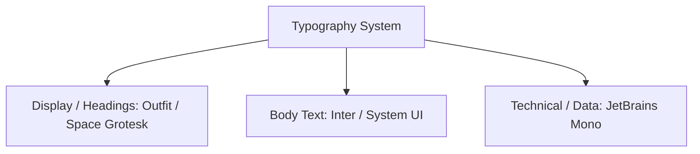

# cl0ud — Typography Scale & Guidelines

> **System Designation:** Visual Design System — Typography  
> **Type Families:** Outfit / Space Grotesk (Display), Inter (Body), JetBrains Mono (Code)  
> **Scale Ratio:** Major Third (1.250)  
> **Specification Reference:** [`cl0ud-brand-spec.json`](file:///Users/roopalisingh/Desktop/cl0ud/cl0ud-brand-spec.json)

---

## 1. Font Family Stacks

cl0ud utilizes three distinct typeface categories to communicate architectural structure and technical rigor:

### 1. Display & Headings: `Outfit` / `Space Grotesk`
- **Fallback Stack:** `Outfit, 'Space Grotesk', -apple-system, BlinkMacSystemFont, 'Segoe UI', Roboto, sans-serif`
- **Application:** Major document titles, hero presentation slides, exhibition placards, and primary section headers.
- **Characteristics:** Geometric, clean circular counters, modern architectural precision.

### 2. Body & Narrative: `Inter`
- **Fallback Stack:** `Inter, -apple-system, BlinkMacSystemFont, 'Segoe UI', Roboto, Helvetica, Arial, sans-serif`
- **Application:** Paragraphs, monographs, technical explanations, and specifications.
- **Characteristics:** Neutral tall x-height, optimized for high legibility across dense technical descriptions.

### 3. Monospace & Code: `JetBrains Mono`
- **Fallback Stack:** `'JetBrains Mono', 'SF Mono', Menlo, Consolas, Monaco, monospace`
- **Application:** Source code, I2C register maps, SI units, terminal logs, and system designations (e.g. `cl0ud`, `PRJ-001`).
- **Characteristics:** Clear distinction between `0` (with dot/slash) and `O`, optimized for hardware registers.

---

## 2. Modular Type Hierarchy (Desktop & Web)

| Hierarchy Role | Font Size (rem / px) | Line Height | Font Weight | Letter Spacing | CSS Equivalent |
| :--- | :--- | :--- | :--- | :--- | :--- |
| **Display H1** | `2.441rem` (39.06px) | `1.2` | 700 (Bold) | `-0.02em` | `font-size: 2.441rem; font-weight: 700;` |
| **Section H2** | `1.953rem` (31.25px) | `1.3` | 600 (Semi-Bold) | `-0.015em` | `font-size: 1.953rem; font-weight: 600;` |
| **Sub-section H3**| `1.563rem` (25.00px) | `1.4` | 600 (Semi-Bold) | `-0.01em` | `font-size: 1.563rem; font-weight: 600;` |
| **Component H4**| `1.250rem` (20.00px) | `1.4` | 600 (Semi-Bold) | `-0.005em` | `font-size: 1.250rem; font-weight: 600;` |
| **Body (Base)** | `1.000rem` (16.00px) | `1.6` | 400 (Regular) | `0em` | `font-size: 1.000rem; line-height: 1.6;` |
| **Caption / Meta**| `0.800rem` (12.80px) | `1.5` | 500 (Medium) | `+0.02em` | `font-size: 0.800rem; letter-spacing: 0.02em;` |
| **Code / Micro**| `0.875rem` (14.00px) | `1.7` | 400 / 600 | `0em` | `font-family: 'JetBrains Mono', monospace;` |

---

## 3. Physical Print & Exhibition Scale (Posters & Plinths)

When preparing exhibition posters (A1/A2) or 3D-printed/laser-engraved plinths:

- **Poster Banner Title:** $\ge 64\text{pt}$ (Outfit Bold)
- **Primary Section Title:** $\ge 28\text{pt}$ (Outfit Semi-Bold)
- **Technical Body Text:** $\ge 14\text{pt}$ (Inter Regular)
- **Schematic Callouts:** $\ge 11\text{pt}$ (JetBrains Mono Regular)
- **Chassis Plinth Attributions:** $\ge 12\text{pt}$ (Outfit Bold + JetBrains Mono)
