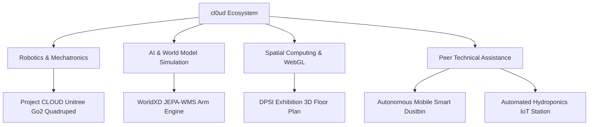

# cl0ud — Engineering Brand Overview

> **System Designation:** Comprehensive Brand Overview & Ecosystem Blueprint  
> **Brand Mark:** cl0ud  
> **Founder & Lead Architect:** Ojas Singh ([`@Ojas-sta`](https://github.com/Ojas-sta) / `ojasctc@gmail.com`)  
> **Specification Reference:** [`cl0ud-brand-spec.json`](file:///Users/roopalisingh/Desktop/cl0ud/cl0ud-brand-spec.json)

---

## 1. Introduction

**cl0ud** is a multidisciplinary engineering brand, research lab, and systems architecture ecosystem founded by **Ojas Singh**.

Originating within the Advanced Robotics and Prototyping makerspaces of **Delhi Public School Indirapuram (DPSI)**, cl0ud exists to provide a reproducible standard for autonomous cyber-physical machines. 

Where conventional student projects often suffer from superficial packaging, fragile wiring, or opaque attribution, cl0ud establishes an engineering standard of record:
- **Mechatronics Integrity:** Real mechanical engineering, load calculations, 3D printing tolerances, and isolated electrical buses.
- **Embedded & AI Determinism:** Grounding theoretical models (e.g. Meta JEPA world models, spatial computer vision) into real-time physical kinematics.
- **Ethical Attribution:** Clearly differentiating what cl0ud builds alone, what cl0ud co-engineers with peer teams, and where cl0ud provides modular technical advisory.

---

## 2. Founder & Collaborator Dynamic

A central rule of the cl0ud ecosystem is that **cl0ud does not claim unilateral ownership of collaborative or school team projects**:

1. **Ojas Singh:** Acts as founder, lead systems architect, and mechatronics builder. On personal research (e.g. `WorldXD`), Ojas is the sole author.
2. **Team Collaborations:** On institutional projects (e.g. `Project CLOUD` with the DPSI Student Robotics Team), cl0ud serves as the systems architecture framework, and Ojas Singh is credited as *Lead Systems Architect & Co-Engineer*.
3. **Peer Projects:** On projects authored by external students (e.g. the *Autonomous Smart Dustbin* or the *Hydroponic IoT Farm*), cl0ud acts as a technical advisory resource, providing circuit reviews, motor tuning, and sensor calibration math while leaving project ownership 100% in the hands of the student inventors.

---

## 3. The cl0ud Engineering Stack

| Domain | Technologies & Frameworks |
| :--- | :--- |
| **Robotics Kinematics** | Unitree Go2 SDK, ROS 2 Humble, CycloneDDS, Micro-ROS, Onshape CAD |
| **Microcontroller Firmware** | Arduino Uno R4 WiFi (Renesas RA4M1), ESP32, Bare-Metal C++, I2C Bus |
| **Perception & Sensors** | Intel RealSense D435i, 4D Hemispherical LiDAR, OpenCV, AprilTags, ArUco |
| **Artificial Intelligence** | Meta JEPA (V-JEPA), PyTorch (Apple Silicon MPS), Whisper, Piper TTS, Ollama |
| **Spatial & 3D Web** | Next.js App Router, Three.js, React Three Fiber (R3F), Zustand, WebGL |
| **Infrastructure & CI/CD** | Cloudflare Pages & Workers, GitHub Actions, Docker, Linux/macOS |

---

## 4. Brand Asset Quick Links
- **Primary Mark:** [`assets/logos/cl0ud-primary.svg`](file:///Users/roopalisingh/Desktop/cl0ud/assets/logos/cl0ud-primary.svg)
- **Monochrome Dark:** [`assets/logos/cl0ud-monochrome-dark.svg`](file:///Users/roopalisingh/Desktop/cl0ud/assets/logos/cl0ud-monochrome-dark.svg)
- **Attribution Badges:** [`assets/badges/`](file:///Users/roopalisingh/Desktop/cl0ud/assets/badges/)
- **Visual Design System:** [`brand/guidelines/brand-manual.md`](file:///Users/roopalisingh/Desktop/cl0ud/brand/guidelines/brand-manual.md)
- **Verified Projects Registry:** [`projects/verified-projects.json`](file:///Users/roopalisingh/Desktop/cl0ud/projects/verified-projects.json)
