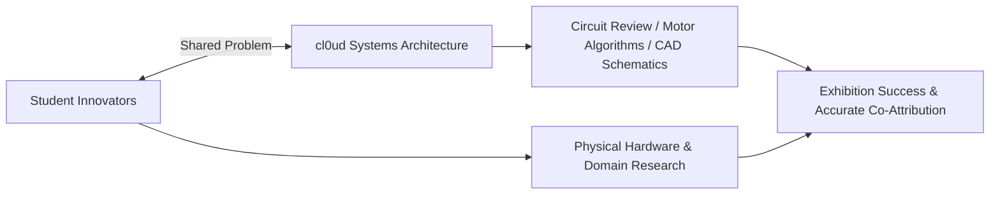

# cl0ud — Engineering Collaboration Model

> **System Designation:** Collaboration Procedures & Partnership Framework  
> **Brand Mark:** cl0ud  
> **Founder & Lead Architect:** Ojas Singh  
> **Specification Reference:** [`cl0ud-brand-spec.json`](file:///Users/roopalisingh/Desktop/cl0ud/cl0ud-brand-spec.json)

---

## 1. Collaboration Philosophy

cl0ud actively partners with student engineering teams, school makerspaces, robotics clubs, and academic departments. We operate on a **clear separation of ownership and mutual technical elevation**:

---

## 2. Modes of Engagement

### Mode 1: Full Co-Engineering (e.g., Project CLOUD)
- **Scope:** cl0ud and Ojas Singh integrate as core systems architects within a formal student robotics team.
- **Deliverables:** Architectural monographs, power distribution harnesses, custom CAD interfaces, and complex state machines.
- **Attribution Standard:** `"Engineered by [Team Name] | Systems Architecture powered by cl0ud | Co-engineered by Ojas Singh"`.

### Mode 2: Modular Technical Assistance (e.g., Smart Dustbin, Hydroponics)
- **Scope:** An independent student team has developed a project concept or physical prototype and requires specialized technical advisory:
  - Debugging unstable motor power buses.
  - Formulating closed-loop PID control or tracking algorithms.
  - Setting up MQTT telemetry or IoT sensor calibration.
- **Ownership Guarantee:** cl0ud **never** claims ownership of the student's idea, mechanical prototype, or project deliverables.
- **Attribution Standard:** `"Project by [Student Team] | Technical Assistance by cl0ud & Ojas Singh"`.

### Mode 3: Platform Integration (e.g., DPSI 3D Exhibition Web App)
- **Scope:** An institution uses cl0ud web or firmware frameworks as the backbone for an institutional event or curriculum.
- **Attribution Standard:** `"Powered by cl0ud | Co-engineered by Ojas Singh"`.

---

## 3. The 4-Step Collaboration Runbook

1. **Intake & Scope Definition:** Complete the [`templates/collaboration-template.md`](file:///Users/roopalisingh/Desktop/cl0ud/templates/collaboration-template.md) to define what cl0ud will assist with and confirm that core ownership remains with the author.
2. **Architecture Review:** Conduct an electrical and mechanical safety review (verifying isolated power domains, wire gauges, and software watchdogs).
3. **Sprint & Testing:** Deliver the code modules, schematics, or calibration scripts.
4. **Exhibition Attributions:** Verify that the project poster, README, and plinth display the appropriate attribution formula before public display.
