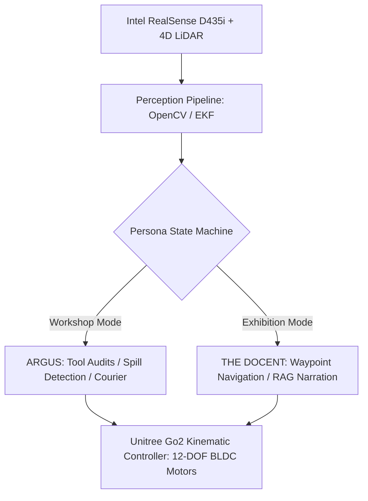
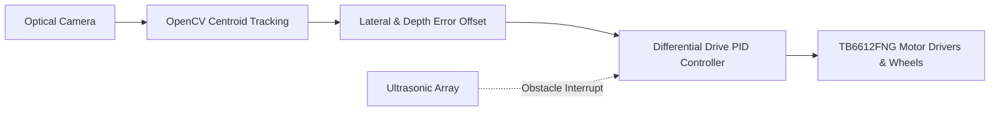
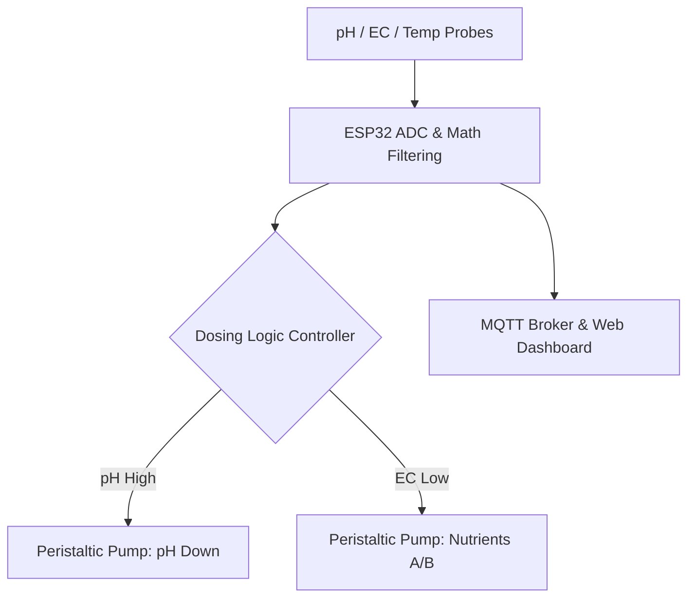

# cl0ud — Verified Engineering Portfolio

> **System Designation:** Technical Case Studies & Verified Engineering Deliverables  
> **Brand Mark:** cl0ud  
> **Lead Systems Architect:** Ojas Singh ([`@Ojas-sta`](https://github.com/Ojas-sta))  
> **Registry Source:** [`projects/verified-projects.json`](file:///Users/roopalisingh/Desktop/cl0ud/projects/verified-projects.json)  
> **Specification Reference:** [`cl0ud-brand-spec.json`](file:///Users/roopalisingh/Desktop/cl0ud/cl0ud-brand-spec.json)

---

## Portfolio Index

1. [`PRJ-001: Project CLOUD Quadruped ARGUS & Docent`](#prj-001-project-cloud-autonomous-quadruped-docent--makerspace-utility-steward)
2. [`PRJ-002: DPSI Exhibition 3D Virtual Floor Plan & Voting Web App`](#prj-002-dpsi-tech--innovation-exhibition-3d-virtual-floor-plan--live-voting-system)
3. [`PRJ-003: WorldXD JEPA-WMS Robotic Arm Simulation Engine`](#prj-003-worldxd-jepa-wms-real-time-robotic-arm-simulation-platform)
4. [`PRJ-004: DPSI TinkerTek Open-Source Firmware & Agentic OS`](#prj-004-dpsi-tinkertek-open-source-firmware--agentic-os)
5. [`PRJ-005: Autonomous Mobile Smart Dustbin with Target Tracking`](#prj-005-autonomous-mobile-smart-dustbin-with-target-tracking)
6. [`PRJ-006: Automated Hydroponic Farming Environmental IoT System`](#prj-006-automated-hydroponic-farming-environmental-iot-system)
7. [`PRJ-007: Spatial-OS & Vision-Track Web Gesture Computing`](#prj-007-spatial-os--vision-track-web-based-spatial-computing-environment)

---

## PRJ-001: Project CLOUD: Autonomous Quadruped Docent & Makerspace Utility Steward

### 1. Project Overview & Problem Statement
Modern makerspaces suffer from operational friction: lost precision hand-tools, unaddressed chemical/solder flux spills, and high logistical overhead during annual exhibitions. Standard wheeled robots fail over workshop cable conduits, thresholds, and uneven floor surfaces. Project CLOUD transforms a commercial 12-DOF **Unitree Go2 Edu quadruped** into a rugged makerspace steward and public exhibition docent.

### 2. Engineering Solution & Dual Cognitive Personas
- **ARGUS (Autonomous Robotic Ground Utility Steward):** Daily workshop operations engine. Uses OpenCV ArUco/AprilTag visual anchoring to verify tool racks, executes mobile courier runs across benches, and detects liquid spills on the workshop floor.
- **THE DOCENT:** Autonomous exhibition tour guide executing pre-mapped deterministic breadcrumb waypoints, engaging visitors with conversational local RAG narration, and performing $180^\circ$ presenter pivots.

### 3. Mechatronics & Power Topology
- **Back-Load Guide Rail Interface:** Custom CNC aluminum and 3D printed mechanical interface bolted directly into the Go2 chassis spine with silicone vibration-isolation bushings.
- **Dual-Bay Utility Caddy:** Rapid-prototyped in chemical-resistant PETG with recessed neodymium magnetic tool latches.
- **Isolated Power Distribution:** $28.8\text{V}$ raw battery tapped via Expansion Dock, stepped down through isolated DC-DC buck converters to $12\text{V}$ (LiDAR/Cameras) and $5\text{V}$ (microcontroller telemetry), protected by transient voltage suppression (TVS) diodes and back-EMF flyback diodes.

### 4. Technical Specifications
- **DOF:** 12 active joints (peak torque $45\text{ N}\cdot\text{m}$, sprint velocity $4.5\text{ m/s}$).
- **Sensory Suite:** Intel RealSense D435i stereo depth camera, ultra-wide hemispherical LiDAR, IMU EKF.
- **Compute & Local AI:** ROS 2 Humble, Unitree Go2 SDK, Whisper Speech Recognition, Piper TTS, Ollama local LLM.

### 5. Verified Contributions
- **Ojas Singh (Lead Systems Architect & Co-Engineer):** Designed guide rail CAD mounts, electrical harness and buck converter topologies, AprilTag tracking pipeline, and Document Revision 5.0.0 Master Technical Monograph.
- **DPSI Student Robotics Team:** Physical assembly, test runs, exhibition booth logistics.
- **Faculty Mentors:** Departmental scrutiny and safety review.

### 6. Attribution & License
- **Attribution:** `"Engineered by DPSI Student Robotics Team | Systems Architecture powered by cl0ud | Co-engineered by Ojas Singh"`
- **License:** DPSI Academic & Institutional License / CC BY 4.0 Monograph.
- **Repository:** [`https://github.com/Ojas-sta/Cloud_DPSI-EXPO26`](https://github.com/Ojas-sta/Cloud_DPSI-EXPO26)

---

## PRJ-002: DPSI Tech & Innovation Exhibition 3D Virtual Floor Plan & Live Voting System

### 1. Project Overview & Problem Statement
Physical school exhibitions struggle with visitor orientation, booth congestion, and rigged voting for student awards. DPSI needed an interactive 3D digital twin of the exhibition concourse paired with a secure, tamper-proof live voting engine that prevents ballot stuffing.

### 2. Engineering Solution
- **Photorealistic Architectural 3D Scene:** Built with Next.js App Router, Three.js, and React Three Fiber (R3F). Features Carrara white satin floor slabs (roughness $0.48$, metalness $0.20$), smooth celestial skyboxes, brushed titanium plinths, and warm directional daylight without shadow acne.
- **4-Layer Anti-Cheat Voting Engine:**
  1. *Canvas/WebGL Device Fingerprinting:* Detects repeat voter browsers across private windows.
  2. *IP Entropy Rate-Limiting:* Prevents automated script floods.
  3. *Honeypot Form Traps:* Catches headless browser bots.
  4. *Cryptographic Session Tokens:* Signed ephemeral tokens required to cast verified votes.

### 3. Verified Contributions
- **Ojas Singh (Lead Web Architect & 3D Developer):** Full 3D scene architecture, PBR shader tuning, Three.js camera transitions, Zustand state management, anti-cheat engine, and Cloudflare Pages CI/CD pipeline.
- **DPSI Organizing Committee:** Booth coordinates, student roster mapping, award categories.

### 4. Attribution & License
- **Attribution:** `"Powered by cl0ud | Co-engineered by Ojas Singh"`
- **License:** MIT License (Web Core) & DPSI Institutional Assets.
- **Live Deployment:** [`https://dpsiexibition.pages.dev`](https://dpsiexibition.pages.dev)
- **Repository:** [`https://github.com/Ojas-sta/dpsi-exhibition`](https://github.com/Ojas-sta/dpsi-exhibition)

---

## PRJ-003: WorldXD: JEPA-WMS Real-Time Robotic Arm Simulation Platform

### 1. Project Overview & Problem Statement
Standard robotic simulation either relies on computationally heavy pixel-level diffusion/autoregression or crude kinematic approximations. WorldXD couples Meta’s **Joint Embedding Predictive Architecture (JEPA)** with low-level analytical inverse kinematics to predict trajectory feasibility in compact latent feature space rather than raw pixels.

### 2. Engineering Solution
- **Apple Silicon MPS Backend:** Formulated with PyTorch Metal Performance Shaders (MPS) for high-efficiency unified memory tensor manipulation on Apple Silicon.
- **Latent Visual Planning:** Trained to predict joint coordinate feasibility within abstract feature representations, ignoring irrelevant visual background noise.
- **Analytical 6-DOF Inverse Kinematics:** Closed-form analytical solver calculating joint angles from target spatial vectors in $< 2\text{ms}$.

### 3. Verified Contributions
- **Ojas Singh (Creator & Sole Author):** Conception, mathematical formulation, PyTorch MPS training script, and kinematic rendering engine.

### 4. Attribution & License
- **Attribution:** `"Created by cl0ud | Engineered by Ojas Singh"`
- **License:** MIT License.
- **Repository:** [`https://github.com/Ojas-sta/WorldXD`](https://github.com/Ojas-sta/WorldXD)

---

## PRJ-004: DPSI TinkerTek Open-Source Firmware & Agentic OS

### 1. Project Overview & Problem Statement
Educational robotics platforms (e.g. School For Schools / s4s ICRobot and ICBricks) often lack modular, low-level open-source drivers, forcing students into locked graphical blocks. DPSI TinkerTek delivers bare-metal C++ drivers, full I2C register maps, and an Agentic OS runtime for the Arduino Uno R4 WiFi.

### 2. Engineering Solution
- **Hardware I2C Register Map:** Designed structured register protocols for motor status, optical encoder feedback, and distance telemetry.
- **Arduino Uno R4 (Renesas RA4M1):** Bare-metal register manipulation combined with ESP32-S3 wireless telemetry streaming.

### 3. Verified Contributions
- **Ojas Singh (Lead Firmware Architect):** Register map specifications, C++ driver libraries, and telemetry bridges.

### 4. Attribution & License
- **Attribution:** `"Co-engineered by Ojas Singh | cl0ud Open Firmware"`
- **License:** Apache 2.0 License.
- **Repository:** [`https://github.com/Ojas-sta/DPSI_TinkerTek`](https://github.com/Ojas-sta/DPSI_TinkerTek)

---

## PRJ-005: Autonomous Mobile Smart Dustbin with Target Tracking

### 1. Project Overview & Problem Statement
Static waste bins in crowded makerspaces or school cafeterias require users to leave their workbenches, leading to accumulated debris and hazardous waste on tables. The Autonomous Mobile Smart Dustbin project is an intelligent robotic mobility base engineered to detect, track, and navigate toward users for hands-free waste disposal.

### 2. Engineering Solution & Technical Assistance
- **Computer Vision Target Tracking:** Uses an onboard optical camera feed processed through OpenCV to detect human target bounding boxes or hand gestures, calculating centroid error offsets in real time.
- **Differential Drive Kinematics:** Closed-loop PID velocity control directing dual DC gearmotors to steer dynamically toward the target while maintaining a safe $0.5\text{m}$ interaction buffer.
- **Ultrasonic Collision Ring:** 3-way ultrasonic sensor array interrupting motor drive if peripheral obstacles enter the trajectory path.

### 3. Verified Contributions & Attribution Separation
- **Student Project Authors:** Core mechanical chassis fabrication, dustbin lid opening servo mechanism, and physical enclosure styling.
- **Ojas Singh / cl0ud (Technical Assistance & Advisory):** 
  - Advised on closed-loop PID kinematic steering equations.
  - Resolved motor driver voltage drop issues by implementing an isolated $7.4\text{V}$ battery rail.
  - Implemented OpenCV optical centroid tracking pipeline.
- **Attribution:** `"Project by Student Innovation Team | Technical Assistance by cl0ud & Ojas Singh"`
- **Ownership Note:** The mechanical design, dustbin enclosure, and intellectual property remain 100% the property of the student project team.

---

## PRJ-006: Automated Hydroponic Farming Environmental IoT System

### 1. Project Overview & Problem Statement
Indoor soilless agriculture requires constant chemical balancing: maintaining pH between $5.5\text{--}6.5$ and Electrical Conductivity (EC) within precise nutrient thresholds. Manual chemical testing is labor-intensive and prone to overshoot that damages plant roots.

### 2. Engineering Solution & Technical Assistance
- **Multi-Sensor Telemetry Station:** High-precision analog pH probe, EC probe, DS18B20 water temperature sensor, and DHT22 ambient humidity sensor connected to an ESP32 microcontroller.
- **Automated Dosing Subsystem:** Dual peristaltic dosing pumps delivering micro-doses of pH-Down and concentrated nutrient solutions based on automated feedback control.
- **IoT Telemetry Bridge:** Lightweight MQTT protocol broadcasting metrics every $5\text{s}$ to an interactive local web dashboard with mobile alerts for parameter drift.

### 3. Verified Contributions & Attribution Separation
- **Hydroponics Research Team:** Plant biology research, seed germination, PVC grow-channel construction, nutrient formula selection.
- **Ojas Singh / cl0ud (Technical Assistance & Advisory):**
  - Formulated analog probe ADC noise-filtering math and 2-point temperature-compensated calibration curves.
  - Engineered safe optoisolated $12\text{V}$ relay switching to prevent inductive spikes from resetting the ESP32.
  - Configured MQTT telemetry publishing pipeline.
- **Attribution:** `"Project by Hydroponics Sustainability Team | Technical Assistance by cl0ud & Ojas Singh"`
- **Ownership Note:** Agricultural bed designs and biological research remain the exclusive intellectual property of the student agriculture team.

---

## PRJ-007: Spatial-OS & Vision-Track: Web-Based Spatial Computing Environment

### 1. Project Overview & Problem Statement
Apple Vision Pro introduced fluid, natural spatial pinch gestures, but requires expensive proprietary hardware. Spatial-OS recreates the spatial computing interaction model inside standard web browsers using pure client-side computer vision.

### 2. Engineering Solution
- **MediaPipe Hand Landmark Pipeline:** Tracks 21 3D hand keypoints in real time via user webcams.
- **Pinch-to-Interact Smoothing:** Dynamic Euclidean distance tracking between index fingertip and thumb with hysteresis debounce.
- **Parallax 3D Canvas:** Renders floating application windows that react with optical depth to user head and hand movements.

### 3. Verified Contributions
- **Ojas Singh (Creator & Author):** Zero-dependency WebGL canvas implementation, gesture threshold math, and UI layout.

### 4. Attribution & License
- **Attribution:** `"Created by cl0ud | Engineered by Ojas Singh"`
- **License:** MIT License.
- **Repository:** [`https://github.com/Ojas-sta/Spatial-OS`](https://github.com/Ojas-sta/Spatial-OS)
