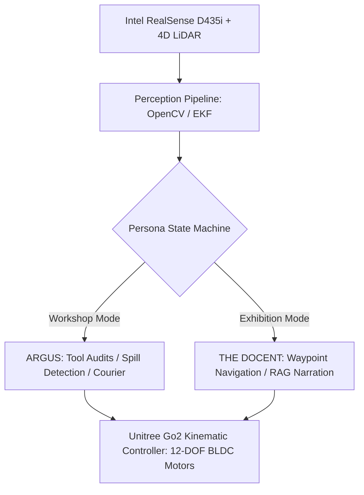
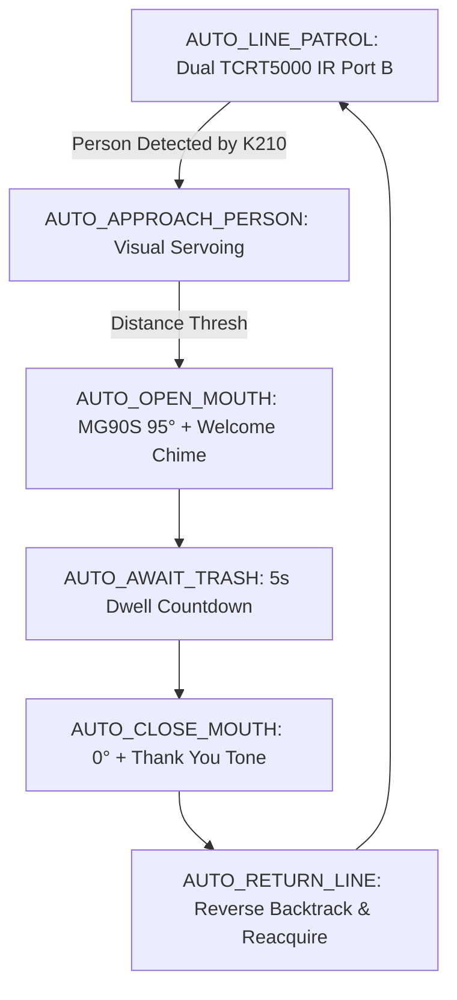
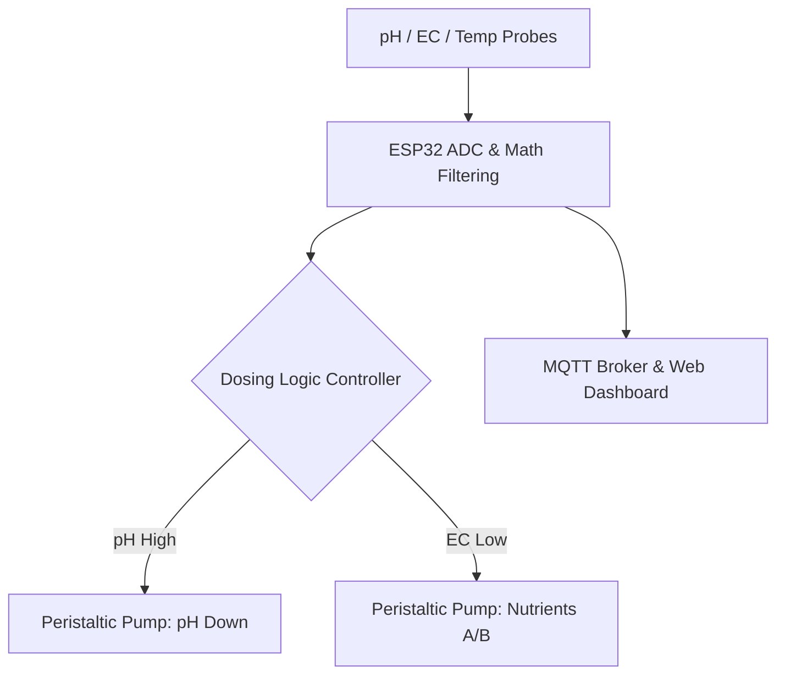

# cl0ud — Verified Engineering Portfolio

> **System Designation:** Technical Case Studies & Verified Engineering Deliverables  
> **Brand Mark:** cl0ud  
> **Lead Systems Architect:** Ojas Singh ([`@Ojas-sta`](https://github.com/Ojas-sta))  
> **Registry Source:** [`projects/verified-projects.json`](file:///Users/roopalisingh/Desktop/cl0ud/projects/verified-projects.json)  
> **Specification Reference:** [`cl0ud-brand-spec.json`](file:///Users/roopalisingh/Desktop/cl0ud/cl0ud-brand-spec.json)

---

## Portfolio Index

1. [`PRJ-001: Project CLOUD Quadruped ARGUS & Docent`](#prj-001-project-cloud-autonomous-quadruped-docent--makerspace-utility-steward)
2. [`PRJ-002: DPSI Exhibition 3D Virtual Floor Plan & Voting Web App`](#prj-002-dpsi-tech--innovation-exhibition-3d-virtual-floor-plan--live-voting-system)
3. [`PRJ-003: WorldXD JEPA-WMS Robotic Arm Simulation Engine`](#prj-003-worldxd-jepa-wms-real-time-robotic-arm-simulation-platform)
4. [`PRJ-004: DPSI TinkerTek Open-Source Firmware & Agentic OS`](#prj-004-dpsi-tinkertek-open-source-firmware--agentic-os)
5. [`PRJ-005: BINZO Smart Autonomous Mecanum Dustbin Robot`](#prj-005-binzo--smart-autonomous-mecanum-dustbin-robot)
6. [`PRJ-006: Automated Hydroponic Farming Environmental IoT System`](#prj-006-automated-hydroponic-farming-environmental-iot-system)
7. [`PRJ-007: Spatial-OS & Vision-Track Web Gesture Computing`](#prj-007-spatial-os--vision-track-web-based-spatial-computing-environment)
8. [`PRJ-008: ESP32 SmartLock Access System`](#prj-008-esp32-smartlock-access-system)

---

## PRJ-001: Project CLOUD: Autonomous Quadruped Docent & Makerspace Utility Steward

[](https://github.com/Ojas-sta/Cloud_DPSI-EXPO26)
[](https://www.unitree.com/)
[](file:///Users/roopalisingh/Desktop/cl0ud/cl0ud-brand-spec.json)

### 1. Project Overview & Problem Statement
Modern makerspaces suffer from operational friction: lost precision hand-tools, unaddressed chemical/solder flux spills, and high logistical overhead during annual exhibitions. Standard wheeled robots fail over workshop cable conduits, thresholds, and uneven floor surfaces. Project CLOUD transforms a commercial 12-DOF **Unitree Go2 Edu quadruped** into a rugged makerspace steward and public exhibition docent.

### 2. Engineering Solution & Dual Cognitive Personas
- **ARGUS (Autonomous Robotic Ground Utility Steward):** Daily workshop operations engine. Uses OpenCV ArUco/AprilTag visual anchoring to verify tool racks, executes mobile courier runs across benches, and detects liquid spills on the workshop floor.
- **THE DOCENT:** Autonomous exhibition tour guide executing pre-mapped deterministic breadcrumb waypoints, engaging visitors with conversational local RAG narration, and performing $180^\circ$ presenter pivots.



### 3. Mechatronics & Power Topology
- **Back-Load Guide Rail Interface:** Custom CNC aluminum and 3D printed mechanical interface bolted directly into the Go2 chassis spine with silicone vibration-isolation bushings.
- **Dual-Bay Utility Caddy:** Rapid-prototyped in chemical-resistant PETG with recessed neodymium magnetic tool latches.
- **Isolated Power Distribution:** $28.8\text{V}$ raw battery tapped via Expansion Dock, stepped down through isolated DC-DC buck converters to $12\text{V}$ (LiDAR/Cameras) and $5\text{V}$ (microcontroller telemetry), protected by transient voltage suppression (TVS) diodes and back-EMF flyback diodes.

### 4. Technical Specifications
- **DOF:** 12 active joints (peak torque $45\text{ N}\cdot\text{m}$, sprint velocity $4.5\text{ m/s}$).
- **Sensory Suite:** Intel RealSense D435i stereo depth camera, ultra-wide hemispherical LiDAR, IMU EKF.
- **Compute & Local AI:** ROS 2 Humble, Unitree Go2 SDK, Whisper Speech Recognition, Piper TTS, Ollama local LLM.

### 5. Verified Contributions
- **Ojas Singh (Lead Systems Architect & Co-Engineer):** Designed guide rail CAD mounts, electrical harness and buck converter topologies, AprilTag tracking pipeline, and Document Revision 5.0.0 Master Technical Monograph.
- **DPSI Student Robotics Team:** Physical assembly, test runs, exhibition booth logistics.
- **Faculty Mentors:** Departmental scrutiny and safety review.

### 6. Attribution & License
- **Attribution:** `"Engineered by DPSI Student Robotics Team | Systems Architecture powered by cl0ud | Co-engineered by Ojas Singh"`
- **License:** DPSI Academic & Institutional License / CC BY 4.0 Monograph.
- **Repository:** [`https://github.com/Ojas-sta/Cloud_DPSI-EXPO26`](https://github.com/Ojas-sta/Cloud_DPSI-EXPO26)

---

## PRJ-002: DPSI Tech & Innovation Exhibition 3D Virtual Floor Plan & Live Anti-Cheat Voting Platform

[](https://dpsiexibition.pages.dev)
[](https://github.com/Ojas-sta/dpsi-exhibition)

### 1. Project Overview & Problem Statement
Physical exhibitions struggle with visitor navigation across complex booths, orientation fatigue, and manipulated community voting. DPSI needed an interactive 3D digital twin of the exhibition concourse paired with an automated cinematic tour, procedural Web Audio soundscape, dynamic visitor credential pass generation, and a tamper-proof 4-tier anti-cheat voting verification pipeline.

### 2. Engineering Solution & Subsystems Breakdown
- **`☁ Expo.Hall` (Photorealistic 3D Scene):** Built with Next.js 16 App Router, Three.js, and React Three Fiber (R3F). Renders Carrara white satin floor slabs (roughness $0.48$, metalness $0.20$), smooth celestial skyboxes, brushed titanium project plinths, and soft directional daylighting across 35 project booths.
- **`☁ Expo.Tour` (6-Waypoint Drone Tour):** Automated camera drone autopilot interpolating between 6 key architectural waypoints across the hall with Bezier velocity smoothing.
- **`☁ Expo.Synth` (Zero-Dependency Web Audio Synth):** Procedural ambient soundscape generated natively in browser via Web Audio API, featuring dynamic frequency modulation and binaural spatial panning without loading external audio files.
- **`☁ Expo.Pass` (Canvas Innovation Delegate Pass):** Dynamic client-side HTML5 canvas pass modal generating personalized high-resolution visitor badges with attendee credentials and QR validation codes.
- **`☁ Expo.Ballot` (4-Tier Anti-Cheat Voting Engine):**
  1. *Hardware Entropy Device Fingerprinting:* ThumbmarkJS canvas/WebGL/audio context entropy hashing.
  2. *IP Entropy Rate-Limiting:* Salted client IP SHA-256 hash rate-limiting (1 vote per booth per device).
  3. *Honeypot Form Traps:* Catches headless browser automation bots.
  4. *Cryptographic Session Tokens:* Signed ephemeral tokens required to submit ballot transactions.

### 3. Verified Contributions
- **Ojas Singh (Lead Web Architect & 3D Developer):** Full 3D scene architecture, PBR shader tuning, Three.js camera transitions, Zustand state management, Web Audio synthesizer, canvas pass generator, anti-cheat engine, and Cloudflare Pages CI/CD pipeline.
- **DPSI Organizing Committee:** Booth coordinates, student roster mapping, award categories.

### 4. Attribution & License
- **Attribution:** `"Powered by cl0ud | Co-engineered by Ojas Singh"`
- **License:** MIT License (Web Core) & DPSI Institutional Assets.
- **Live Deployment:** [`https://dpsiexibition.pages.dev`](https://dpsiexibition.pages.dev)
- **Repository:** [`https://github.com/Ojas-sta/dpsi-exhibition`](https://github.com/Ojas-sta/dpsi-exhibition)
- **Subsystem Composition:** `☁ Expo.Hall`, `☁ Expo.Tour`, `☁ Expo.Synth`, `☁ Expo.Pass`, `☁ Expo.Ballot`

---

## PRJ-003: WorldXD: JEPA-WMS Real-Time Robotic Arm Simulation Platform

[](https://github.com/Ojas-sta/WorldXD)
[](https://github.com/Ojas-sta/WorldXD)

### 1. Project Overview & Problem Statement
Standard robotic simulation either relies on computationally heavy pixel-level diffusion/autoregression or crude kinematic approximations. WorldXD couples Meta’s **Joint Embedding Predictive Architecture (JEPA)** with low-level analytical inverse kinematics to predict trajectory feasibility in compact latent feature space rather than raw pixels.

### 2. Engineering Solution
- **Apple Silicon MPS Backend:** Formulated with PyTorch Metal Performance Shaders (MPS) for high-efficiency unified memory tensor manipulation on Apple Silicon.
- **Latent Visual Planning:** Trained to predict joint coordinate feasibility within abstract feature representations, ignoring irrelevant visual background noise.
- **Analytical 6-DOF Inverse Kinematics:** Closed-form analytical solver calculating joint angles from target spatial vectors in $< 2\text{ms}$.

### 3. Verified Contributions
- **Ojas Singh (Creator & Sole Author):** Conception, mathematical formulation, PyTorch MPS training script, and kinematic rendering engine.

### 4. Attribution & License
- **Attribution:** `"Created by cl0ud | Engineered by Ojas Singh"`
- **License:** MIT License.
- **Repository:** [`https://github.com/Ojas-sta/WorldXD`](https://github.com/Ojas-sta/WorldXD)

---

## PRJ-004: DPSI TinkerTek Open-Source Firmware & Agentic OS

[](https://github.com/Ojas-sta/DPSI_TinkerTek)

### 1. Project Overview & Problem Statement
Educational robotics platforms (e.g. School For Schools / s4s ICRobot and ICBricks) often lack modular, low-level open-source drivers, forcing students into locked graphical blocks. DPSI TinkerTek delivers bare-metal C++ drivers, full I2C register maps, and an Agentic OS runtime for the Arduino Uno R4 WiFi.

### 2. Engineering Solution
- **Hardware I2C Register Map:** Designed structured register protocols for motor status, optical encoder feedback, and distance telemetry.
- **Arduino Uno R4 (Renesas RA4M1):** Bare-metal register manipulation combined with ESP32-S3 wireless telemetry streaming.

### 3. Verified Contributions
- **Ojas Singh (Lead Firmware Architect):** Register map specifications, C++ driver libraries, and telemetry bridges.

### 4. Attribution & License
- **Attribution:** `"Co-engineered by Ojas Singh | cl0ud Open Firmware"`
- **License:** Apache 2.0 License.
- **Repository:** [`https://github.com/Ojas-sta/DPSI_TinkerTek`](https://github.com/Ojas-sta/DPSI_TinkerTek)

---

## PRJ-005: BINZO — Smart Autonomous Mecanum Dustbin Robot

[](https://github.com/Ojas-sta)
[](file:///Users/roopalisingh/Desktop/cl0ud/cl0ud-brand-spec.json)

### 1. Project Overview & Problem Statement
Static waste bins in busy makerspaces or exhibition halls require visitors to search for disposal points, causing waste buildup. BINZO is an autonomous holonomic service robot platform designed to patrol autonomously, track humans via edge AI vision, navigate directly toward users, and present an articulated motorized waste mouth.

### 2. Engineering Solution & Hardware Interconnect
- **`☁ Binzo.Core` (M5Stack Core2 Supervisor):** ESP32-D0WDQ6-V3 dual-core host with a $320\times 240$ capacitive touch LCD dashboard displaying live WiFi SSID, battery voltage, active mission state (`LINE_PATROL`, `APPROACH`, `OPEN_MOUTH`), IR diagnostic cards, motor inversion toggles, speed sliders, and hardware E-STOP.
- **`☁ Binzo.Holonomic` (4WD Mecanum Vector Drivetrain):** 4-wheel independent vector kinematics driven over I2C by an M5Module4EncoderMotor (address `0x24`), delivering omnidirectional forward, lateral strafe, and zero-radius axial yaw locomotion.
- **`☁ Binzo.Patrol` (Dual TCRT5000 IR Patrol Array):** Line following sensors on Port B (Left: GPIO 26, Right: GPIO 36) executing high-speed ground tracking.
- **`☁ Binzo.Sight` (Edge AI Visual Servoing):** M5StickV / UnitV coprocessor (Kendryte K210 RISC-V with KPU) running onboard YOLOv2 Tiny person detection. Connected via Port C UART2 (GPIO 13/14 at 115200 baud) to feed target centroid error offsets into proportional steering loops.
- **`☁ Binzo.Mouth` (Articulated Lid Servo):** MG90S micro-servo ($0^\circ \rightleftarrows 95^\circ$) opening automatically on human approach with acoustic chime audio feedback.
- **`☁ Binzo.Telemetry` (UDP Radio Bridge):** Asynchronous telemetry bridge (`binzo/laptop_controller/radio_bridge.py`) for live laptop telemetry inspection and manual joystick override.



### 3. Verified Contributions & Attribution Separation
- **Ojas Singh (Lead Robotics & Systems Architect):** Full robot systems architecture: M5Core2 firmware, 4WD Mecanum holonomic inverse kinematics solver, M5Module4EncoderMotor I2C driver integration, Port B/C hardware pinout allocation, K210 YOLOv2 visual servoing UART pipeline, 320x240 touchscreen UI diagnostics, non-blocking FSM mission state machine, and UDP telemetry bridge.
- **Mechatronics Innovation Team:** Physical chassis cutting, bin barrel mounting, battery bracket fabrication.
- **Attribution:** `"Powered by cl0ud | Co-engineered by Ojas Singh"`
- **Subsystem Composition:** `☁ Binzo.Core`, `☁ Binzo.Holonomic`, `☁ Binzo.MotorDriver`, `☁ Binzo.Patrol`, `☁ Binzo.Sight`, `☁ Binzo.Mouth`, `☁ Binzo.Telemetry`, `☁ Binzo.FSM`

---

## PRJ-006: Automated Hydroponic Farming Environmental IoT System

[](https://github.com/Ojas-sta)
[](file:///Users/roopalisingh/Desktop/cl0ud/cl0ud-brand-spec.json)

### 1. Project Overview & Problem Statement
Indoor soilless agriculture requires constant chemical balancing: maintaining pH between $5.5\text{--}6.5$ and Electrical Conductivity (EC) within precise nutrient thresholds. Manual chemical testing is labor-intensive and prone to overshoot that damages plant roots.

### 2. Engineering Solution & Technical Assistance
- **Multi-Sensor Telemetry Station:** High-precision analog pH probe, EC probe, DS18B20 water temperature sensor, and DHT22 ambient humidity sensor connected to an ESP32 microcontroller.
- **Automated Dosing Subsystem:** Dual peristaltic dosing pumps delivering micro-doses of pH-Down and concentrated nutrient solutions based on automated feedback control.
- **IoT Telemetry Bridge:** Lightweight MQTT protocol broadcasting metrics every $5\text{s}$ to an interactive local web dashboard with mobile alerts for parameter drift.



### 3. Verified Contributions & Attribution Separation
- **Hydroponics Research Team:** Plant biology research, seed germination, PVC grow-channel construction, nutrient formula selection.
- **Ojas Singh / cl0ud (Technical Assistance & Advisory):**
  - Formulated analog probe ADC noise-filtering math and 2-point temperature-compensated calibration curves.
  - Engineered safe optoisolated $12\text{V}$ relay switching to prevent inductive spikes from resetting the ESP32.
  - Configured MQTT telemetry publishing pipeline.
- **Attribution:** `"Project by Hydroponics Sustainability Team | Technical Assistance by cl0ud & Ojas Singh"`
- **Ownership Note:** Agricultural bed designs and biological research remain the exclusive intellectual property of the student agriculture team.

---

## PRJ-007: Spatial-OS & Vision-Track: Web-Based Spatial Computing Environment

[](https://github.com/Ojas-sta/Spatial-OS)

### 1. Project Overview & Problem Statement
Apple Vision Pro introduced fluid, natural spatial pinch gestures, but requires expensive proprietary hardware. Spatial-OS recreates the spatial computing interaction model inside standard web browsers using pure client-side computer vision.

### 2. Engineering Solution
- **MediaPipe Hand Landmark Pipeline:** Tracks 21 3D hand keypoints in real time via user webcams.
- **Pinch-to-Interact Smoothing:** Dynamic Euclidean distance tracking between index fingertip and thumb with hysteresis debounce.
- **Parallax 3D Canvas:** Renders floating application windows that react with optical depth to user head and hand movements.

### 3. Verified Contributions
- **Ojas Singh (Creator & Author):** Zero-dependency WebGL canvas implementation, gesture threshold math, and UI layout.

### 4. Attribution & License
- **Attribution:** `"Created by cl0ud | Engineered by Ojas Singh"`
- **License:** MIT License.
- **Repository:** [`https://github.com/Ojas-sta/Spatial-OS`](https://github.com/Ojas-sta/Spatial-OS)

---

## PRJ-008: ESP32 SmartLock Access System

[](https://github.com/Ojas-sta/cl0ud-brand-engineering)
[](https://github.com/Ojas-sta)

### 1. Project Overview & Problem Statement
Commercial smart locks often require proprietary cloud backends, continuous external Wi-Fi router connectivity, or vulnerability-prone mobile app Bluetooth syncs. In offline environments, school laboratories, or secure server cabinets, access control must operate with zero internet dependencies while maintaining cryptographically fresh, verifiable authentication.

The **ESP32 SmartLock Access System** is an offline-first, dual-factor physical access controller. It merges a **self-hosted Wi-Fi authentication portal** with a **hardware matrix keypad**, **I2C character display**, and **50 Hz PWM servo door latch**.

### 2. System Architecture & Flow

```
                  +----------------------------------------------------------+
                  |                     ESP32 Dev Module                     |
                  |                                                          |
 [Smartphone/PC]  |  +--------------------+               +---------------+  |
        |         |  |   Wi-Fi SoftAP     |               | Dynamic OTP   |  |
        +========>|  | "ESP32-SmartLock"  |-------------->| Generator     |  |
    (HTTP :80)    |  |  (192.168.4.1)     |               | (1000 - 9999) |  |
                  |  +--------------------+               +-------+-------+  |
                  |                                               |          |
                  |  +--------------------+                       v          |
 [HX543 Keypad] --+->| Keypad Scanner     |================ [OTP Match?]     |
 (8-pin Matrix)   |  | (Debounced Matrix) |                       |          |
                  |  +--------------------+                       |          |
                  |                                               |          |
                  |  +--------------------+                       | YES      |
 [16x2 I2C LCD] <-+--| LiquidCrystal_I2C  |<----------------------+          |
   (GPIO 21/22)   |  | Real-Time Feedback |                       v          |
                  |  +--------------------+               +---------------+  |
                  |                                       | Hardware PWM  |--+-> [Door Servo]
                  |                                       | Actuator (18) |      (0° ⇄ 90°)
                  +---------------------------------------+---------------+--+
```

### 3. Hardware Interconnect & Final Pinout

All pins were empirically validated through hardware bus diagnostics:

| Subsystem Lockup | Component Pin | ESP32 GPIO | Interface Type | Role |
| :--- | :--- | :--- | :--- | :--- |
| `[☁] Access • Feedback` | LCD SDA | **GPIO 21** | I2C (Bus addr `0x27`) | Data line for $16\times 2$ character display |
| `[☁] Access • Feedback` | LCD SCL | **GPIO 22** | I2C (Bus addr `0x27`) | Clock line for $16\times 2$ character display |
| `[☁] Access • Latch` | Servo PWM | **GPIO 18** | 50 Hz Hardware LEDC PWM | $0^\circ$ (Locked) $\rightleftarrows$ $90^\circ$ (Unlocked) |
| `[☁] Access • Keypad` | Pin 1 (R1) | **GPIO 13** | Matrix Row 1 | Keys `1`, `2`, `3`, `A` |
| `[☁] Access • Keypad` | Pin 2 (C4) | **GPIO 12** | Matrix Col 4 | Keys `A`, `B`, `C`, `D` |
| `[☁] Access • Keypad` | Pin 3 (C3) | **GPIO 14** | Matrix Col 3 | Keys `3`, `6`, `9`, `#` |
| `[☁] Access • Keypad` | Pin 4 (C2) | **GPIO 27** | Matrix Col 2 | Keys `2`, `5`, `8`, `0` |
| `[☁] Access • Keypad` | Pin 5 (C1) | **GPIO 26** | Matrix Col 1 | Keys `1`, `4`, `7`, `*` |
| `[☁] Access • Keypad` | Pin 6 (R4) | **GPIO 25** | Matrix Row 4 | Keys `*`, `0`, `#`, `D` |
| `[☁] Access • Keypad` | Pin 7 (R3) | **GPIO 33** | Matrix Row 3 | Keys `7`, `8`, `9`, `C` |
| `[☁] Access • Keypad` | Pin 8 (R2) | **GPIO 32** | Matrix Row 2 | Keys `4`, `5`, `6`, `B` |

### 4. Operational Flow & Finite State Machine

```
[Web Portal] ──> Displays 4-digit OTP & "LOCKED" status
      │
      ▼
[User Entry] ──> Types digits on 4x4 keypad (LCD echoes digits)
      │
      ├── [* Key] ──> Clears input buffer & resets prompt
      │
      └── [# Key] ──> Submits code for validation
            │
            ├── INVALID ──> LCD displays "Invalid OTP! Try Again..."
            │
            └── VALID ────> 1. LCD displays "Access Granted! Door Unlocked"
                            2. Servo rotates to 90° (Latch opens)
                            3. Web portal badge updates to "UNLOCKED"
                            4. 5-second non-blocking countdown triggers
                            5. Servo returns to 0° (Auto-relocks)
                            6. Fresh OTP is automatically generated
```

### 5. Verified Contributions & Attribution
- **Ojas Singh (Lead Embedded & Hardware Systems Architect):** Complete hardware architecture, Infrastructure-as-Circuit (IAC) pinout allocation, non-blocking `millis()` FSM design, debounced 4x4 matrix keypad scanning, I2C 16x2 LCD driver integration, 50 Hz hardware LEDC PWM servo latch control, self-hosted SoftAP HTTP server implementation, dynamic OTP generation logic, and isolated power decoupling design.
- **Attribution:** `"Powered by cl0ud | Co-engineered by Ojas Singh"`
- **Subsystem Composition:** `☁ Access.Portal`, `☁ Access.OTP`, `☁ Access.Keypad`, `☁ Access.Latch`, `☁ Access.Feedback`, `☁ Access.FSM`, `☁ Access.IAC`
- **Repository:** [`https://github.com/Ojas-sta/cl0ud-brand-engineering`](https://github.com/Ojas-sta/cl0ud-brand-engineering)

