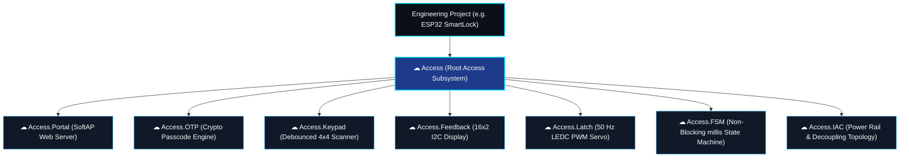
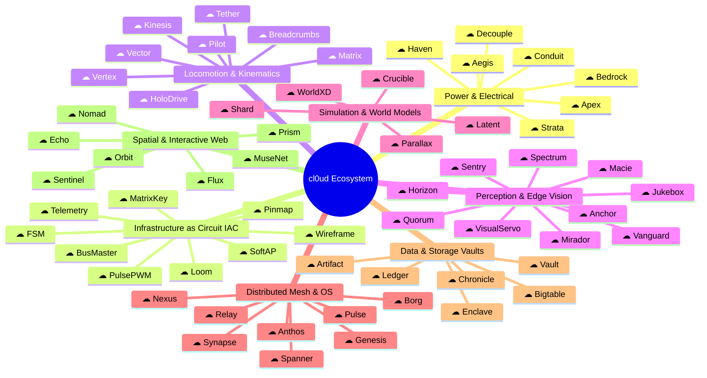

# cl0ud — Subsystem, Product & Infrastructure Catalog (Expanded Standard)

> **System Designation:** Architectural Subsystem Taxonomy, Embedded Infrastructure-as-Circuit (IAC) & Hierarchical Lockup Standard  
> **Brand Lockup Paradigm:** `[cl0ud Logo]` + `[Subsystem Name]` (Apple-style inline symbol lockup)  
> **Hierarchical Subsystem Notation:** `☁ Parent.Child` / `[☁] Parent • Child` (Subsystems inside of Subsystems)  
> **Lead Systems Architect:** Ojas Singh ([`@Ojas-sta`](https://github.com/Ojas-sta))  
> **Specification Reference:** [`cl0ud-brand-spec.json`](file:///Users/roopalisingh/Desktop/cl0ud/cl0ud-brand-spec.json)

---

## 1. Executive Overview & The Apple Lockup Paradigm

In the cl0ud engineering architecture, individual subsystems, internal services, products, and infrastructure layers follow the **unified inline glyph lockup model** pioneered by Apple (e.g., `Card`, `Pay`, `Watch`, `Vision`).

Instead of typing the verbose text `cl0ud Bedrock`, the official symbol stands in directly:
```
[☁] Bedrock    [☁] Wireframe    [☁] Borg    [☁] Breadcrumbs    [☁] Artifact
```

### Visual Lockup Standards
- **Symbol-to-Cap Ratio:** The infinity-cloud symbol height is scaled to exactly **$1.05\times$** the font cap-height.
- **Horizontal Kerning Gap:** Spacing between the rightmost edge of the cloud symbol and the first glyph of the subsystem name is strictly **$0.38\text{--}0.42\times$** cap-height.
- **Baseline Alignment:** The horizontal base stroke of the infinity-cloud symbol anchors along the font baseline.
- **Primary Typeface:** **Outfit** (Semi-Bold 600 / Bold 700) or **Space Grotesk**.
- **Surface Finishes:** High-contrast Monochrome, Electric Cyan, or Prismatic Titanium gradient (matching `Card`).

---

## 2. The Hierarchical Subsystem Paradigm ("Subsystems Inside Subsystems")

Real-world cyber-physical engineering projects are not monolithic blocks; they decompose into **functional domains**, which in turn decompose into **specialized nested sub-subsystems**.

### Formal Architectural Notation
1. **Canonical Monospace Code Notation:**
   - Root Domain: `☁ Domain`
   - Second-Level Nested Subsystem: `☁ Domain.Subsystem`
   - Third-Level Leaf Subsystem: `☁ Domain.Subsystem.Leaf`
   - *Examples:* `☁ Access.OTP`, `☁ Access.Latch`, `☁ Binzo.Holonomic`, `☁ Binzo.Sight`, `☁ Expo.Hall`, `☁ Bedrock.Decouple`, `☁ Loom.IAC`.

2. **Apple-Style Inline Breadcrumb Lockup:**
   - Visual format: `[☁] Parent • Child` or `[☁] Parent // Child`
   - Parent subsystem name rendered in **Outfit Semi-Bold 600** (`#F8FAFC`).
   - Breadcrumb delimiter (`•` U+2022) styled in **Electric Cyan** (`#00E5FF`) with $0.4\times$ cap-height optical spacing.
   - Child subsystem name rendered in **Outfit Medium 500** (`#94A3B8`).

3. **Hierarchical Stacked Lockup:**
   ```
   [☁] Access
       ↳ Latch
   ```



---

## 3. Core Subsystems Catalog by Architectural Layer



---

## Layer 1: Power Topology, Decoupling & Electrical Infrastructure

### 1. `☁ Bedrock`
- **Etymology:** Metaphorical borrowing from foundational geology and AWS Bedrock; represents the immovable base electrical and mechanical foundation upon which all autonomy rests.
- **Technical Function:** Multi-rail isolated power distribution board and DC-DC step-down buck regulation infrastructure. Regulates raw high-voltage battery inputs ($28.8\text{V}$ Unitree Go2 or $14.8\text{V}$ LiPo packs) down to isolated $12\text{V}$, $5\text{V}$, and $3.3\text{V}$ buses with zero ground loop interference.
- **Key Hardware:** Optocoupled buck converters, low-ESR solid aluminum electrolytic capacitors, and LC filtering stages.

### 2. `☁ Conduit`
- **Etymology:** Rhetorical term for a protected channel that conveys essential fluid/current; inspired by high-voltage transmission architecture.
- **Technical Function:** High-current shielded power harness equipped with inline transient voltage suppression (TVS) diodes, reverse-polarity P-channel MOSFET gates, and dynamic current-shunt telemetry sensors ($100\text{Hz}$ sample rate).

### 3. `☁ Strata`
- **Etymology:** Layered geological formations; represents the physical multi-cell state layers of battery energy storage.
- **Technical Function:** Real-time Lithium-Ion/LiPo battery health analyzer and cell impedance estimator. Computes dynamic Internal Resistance (IR) in $\text{m}\Omega$, Coulomb-counting State of Charge (SoC), and State of Health (SoH) metrics to predict thermal limits before high-torque motor sprints.

### 4. `☁ Haven`
- **Etymology:** A secure harbor or refuge; represents thermal protection and component survival.
- **Technical Function:** Active and passive thermal management supervisor. Monitors thermocouple nodes across motor stator shells, compute exhaust heatsinks (Jetson/Raspberry Pi), and step-down coils, dynamically adjusting PWM fan cooling curves and throttling motor outputs during high ambient heat.

### 5. `☁ Aegis`
- **Etymology:** The mythological divine shield; represents complete electrical defense.
- **Technical Function:** Fast-acting hardware surge and electrostatic discharge (ESD) protection layer. Clamps inductive back-EMF spikes generated during sudden quadruped BLDC motor deceleration ($< 5\text{ns}$ response time) to protect sensitive RealSense camera logic boards and microcontrollers.

### 6. `☁ Decouple`
- **Etymology:** The intentional physical and electrical decoupling of noisy inductive circuits from sensitive digital logic.
- **Technical Function:** Power rail integrity, inductive noise suppression, and brownout prevention infrastructure. Enforces standardized dual-capacitor decoupling filter stages (bulk $100\mu\text{F}\text{--}470\mu\text{F}$ low-ESR electrolytic in parallel with $0.1\mu\text{F}$ high-frequency ceramic MLCC) across dynamic actuators (MG90S servos, high-torque motor drivers) to isolate microcontroller $5\text{V}/3.3\text{V}$ rails from transient voltage sags.

### 7. `☁ Apex`
- **Etymology:** The highest peak; represents boundary limiters and dynamic thresholds.
- **Technical Function:** Dynamic peak motor torque and stator current limiter. Intercepts instantaneous actuator demands exceeding safe mechanical limits, smoothing trajectory pulses through cubic acceleration tapering to prevent motor driver MOSFET thermal breakdown.

---

## Layer 2: Infrastructure-as-Circuit (IAC), Embedded Wiring & Hardware Topology

### 8. `☁ Loom`
- **Etymology:** The industrial textile machine; symbolizes the intricate, interwoven wiring harness of complex mechatronic systems.
- **Technical Function:** Automated wiring harness CAD routing, pinout matrix mapping, and crimp-connector documentation tool. Enforces color-coded silicone wire standards (18 AWG power, 26 AWG I2C telemetry, twisted-pair CAN bus) across all physical chassis.

### 9. `☁ Wireframe`
- **Etymology:** The foundational wire structure of 3D modeling applied to physical circuit traces; replacing legacy code assistants with hardware-as-code automation.
- **Technical Function:** Declarative Infrastructure-as-Circuit (IAC) pinout compiler and netlist assertion engine. Parses structured YAML/JSON hardware definitions, validates electrical compatibility, checks logic level mismatches ($3.3\text{V} \leftrightarrow 5\text{V}$), generates C++ header files (`pins.h`), and validates pin collision graphs prior to physical breadboarding.

### 10. `☁ Pinmap`
- **Etymology:** Hardware pin mapping and resource allocation.
- **Technical Function:** Microcontroller GPIO assignment manager and hardware strapping pin conflict resolver. Enforces safe hardware constraints on platforms like ESP32 (flagging strapping pins GPIO 0, 2, 12, 15; preventing ADC2 conflicts when Wi-Fi is active; and enforcing input-only constraints on GPIO 34-39).

### 11. `☁ BusMaster`
- **Etymology:** Hardware bus arbiter and multi-drop communication master.
- **Technical Function:** Multi-drop hardware bus manager (I2C, SPI, UART). Scans and maps 7-bit I2C address spaces (e.g. distinguishing a $16\times 2$ LCD at `0x27` from an M5Module4EncoderMotor at `0x24`), calculates required bus pull-up resistance ($4.7\text{ k}\Omega$ vs $2.2\text{ k}\Omega$) based on trace capacitance, and arbitrates multi-UART hardware channels.

### 12. `☁ PulsePWM`
- **Etymology:** High-precision pulse-width modulation control.
- **Technical Function:** Hardware timer-based PWM frequency and duty cycle infrastructure. Configures ESP32 LEDC hardware channels (16-bit resolution at 50 Hz for servo pulse widths between $1.0\text{ms}$ and $2.0\text{ms}$) and high-frequency $20\text{kHz}$ ultrasonic motor PWM, eliminating audible coil whine and jitter.

### 13. `☁ MatrixKey`
- **Etymology:** Scanning cross-point matrix keypads.
- **Technical Function:** High-speed debounced matrix keypad scanner. Implements non-blocking row-strobe and column-sense state machines with a $20\text{ms}$ debounce window, ghost-key suppression, and hardware input buffering across 8-pin 4x4 matrix keypads (e.g. HX543).

### 14. `☁ SoftAP`
- **Etymology:** Software-enabled Access Point; local wireless infrastructure without external dependencies.
- **Technical Function:** Offline captive-portal and self-hosted Wi-Fi Access Point stack. Serves dynamic local HTML5/CSS3 dark-mode control panels directly from microcontroller flash without requiring any external router or internet connectivity.

### 15. `☁ FSM`
- **Etymology:** Finite State Machine.
- **Technical Function:** Deterministic non-blocking finite state machine supervisor. Replaces blocking `delay()` calls with elapsed `millis()` timers, timeout guards, and deterministic state transitions across embedded automation workflows.

### 16. `☁ Telemetry`
- **Etymology:** Remote automated measurement and data transmission.
- **Technical Function:** Lightweight asynchronous binary/JSON radio telemetry bridge. Connects embedded robots to remote operator dashboards over UDP/WebSockets for live telemetry inspection (battery, RSSI, IR status) and manual joystick override.

---

## Layer 3: Locomotion, Kinematics & Mechatronics

### 17. `☁ Vertex`
- **Etymology:** A point where two or more curves, lines, or edges meet; borrowing from Google Cloud Vertex AI, but grounding it in spatial joint geometry.
- **Technical Function:** Closed-form analytical Inverse Kinematics (IK) and Jacobian velocity matrix engine for multi-axis serial robotic arms and quadruped leg links.
- **Mathematical Core:**
  $$\mathbf{J}(\boldsymbol{\theta}) = \begin{bmatrix} \frac{\partial \mathbf{p}}{\partial \theta_1} & \cdots & \frac{\partial \mathbf{p}}{\partial \theta_n} \\ \mathbf{z}_1 & \cdots & \mathbf{z}_n \end{bmatrix}$$

### 18. `☁ Kinesis`
- **Etymology:** Movement in response to a stimulus; borrowing AWS Kinesis stream semantics and applying them to high-frequency actuator control loops.
- **Technical Function:** Deterministic $500\text{Hz}$ cyclic real-time motor controller. Streams synchronized torque, target position, and velocity feedforward commands across multi-DOF actuators.

### 19. `☁ HoloDrive`
- **Etymology:** Holonomic omnidirectional drivetrain kinematics.
- **Technical Function:** 4WD Mecanum wheel vector kinematic solver. Resolves independent Cartesian inputs (forward velocity $V_x$, lateral strafe $V_y$, and rotational yaw $\omega_z$) into discrete 4-channel motor encoder RPM and direction vectors with speed-limiting ramps and motor inversion matrices:
  $$\begin{bmatrix} \omega_1 \\ \omega_2 \\ \omega_3 \\ \omega_4 \end{bmatrix} = \frac{1}{R} \begin{bmatrix} 1 & -1 & -(L_x + L_y) \\ 1 & 1 & (L_x + L_y) \\ 1 & 1 & -(L_x + L_y) \\ 1 & -1 & (L_x + L_y) \end{bmatrix} \begin{bmatrix} V_x \\ V_y \\ \omega_z \end{bmatrix}$$

### 20. `☁ Breadcrumbs`
- **Etymology:** Visualizing historical paths; borrowing user experience metaphors for navigation traces.
- **Technical Function:** Spatial waypoint tracking and topological graph odometry module. Records continuous Cartesian coordinate histories $(x, y, z, \theta)$ with covariance confidence ellipsoids.

### 21. `☁ Vector`
- **Etymology:** A quantity having direction as well as magnitude.
- **Technical Function:** Dynamic obstacle evasion and dynamic window approach (DWA) path planner. Projects velocity candidate arcs into a 2D costmap grid, weighting trajectories by distance to goal, obstacle clearance, and forward velocity.

### 22. `☁ Matrix`
- **Etymology:** A rectangular array of numbers or values; inspired by mathematical transformations.
- **Technical Function:** Coordinate frame transformation pipeline (`tf2` wrapper). Maintains high-precision SE(3) spatial transformation matrices across sensor coordinate frames (`base_link`, `camera_link`, `lidar_link`).

### 23. `☁ Pilot`
- **Etymology:** The human or autonomous entity that guides a craft.
- **Technical Function:** High-level autonomous mission supervisor. Manages transitions between mission phases (Patrol, Intercept, Inspection, Docking, Charging) via behavior trees.

### 24. `☁ Tether`
- **Etymology:** A line or rope that holds something within a specific radius.
- **Technical Function:** Dynamic geofence boundary enforcer and dead-man safety leash. Monitors radio signal link quality and kinematic boundary envelopes; issues an emergency stop (`E-STOP`) if boundary violations occur.

---

## Layer 4: Perception, Edge AI & Visual Servoing

### 25. `☁ Horizon`
- **Etymology:** The line at which the earth's surface and the sky appear to meet; borrowing OpenStack Horizon metaphors for global spatial awareness.
- **Technical Function:** 3D point-cloud feature extraction and ground-plane segmentation module. Processes $360^\circ$ ultra-wide LiDAR scans and RealSense depth feeds to detect step hazards, curbs, and stairwells.

### 26. `☁ Mirador`
- **Etymology:** A high vantage point or watchtower commanding an extensive view.
- **Technical Function:** Pan-tilt stereoscopic optical head controller and target tracker. Coordinates high-speed gimbal servo motors to keep human faces, QR codes, or laboratory tool tags centered in camera frames.

### 27. `☁ Anchor`
- **Etymology:** A device used to secure a vessel to a bed of water; represents spatial ground truth.
- **Technical Function:** Sub-centimeter AprilTag and optical fiducial marker localization engine. Computes relative 6-DOF camera poses from physical tag targets (e.g. tag family `tag36h11`) to guide millimeter-accurate payload placement.

### 28. `☁ VisualServo`
- **Etymology:** Closed-loop visual servoing and edge vision tracking.
- **Technical Function:** Edge AI optical tracking and proportional-integral steering controller. Interfaces with onboard vision coprocessors (Kendryte K210, OpenMV, RealSense) over high-speed UART to track bounding-box centroids (YOLOv2 Tiny person detection) and compute proportional steering adjustments in real time.

### 29. `☁ Jukebox`
- **Etymology:** Automatic music player; borrowing OpenAI Jukebox semantics for acoustic synthesis.
- **Technical Function:** Acoustic signature and anomaly detection engine. Analyzes continuous microphone array audio feeds with fast Fourier transform (FFT) spectrograms to detect high-frequency bearing whine or abnormal friction before mechanical failure.

### 30. `☁ Macie`
- **Etymology:** Borrowed from AWS Macie (data security / classification); applied to physical machine-vision hazard classification.
- **Technical Function:** Surface anomaly, obstacle, and liquid spill classifier. Analyzes RealSense RGB frames using lightweight convolutional neural networks (MobileNetV3) to detect floor hazards and tool status.

### 31. `☁ Quorum`
- **Etymology:** The minimum number of members of an assembly that must be present to make decisions valid.
- **Technical Function:** Multi-sensor consensus and Kalman filter fusion layer. Fuses IMU angular velocity, wheel odometry pulses, and optical flow vectors with dynamic covariance gating.

### 32. `☁ Vanguard`
- **Etymology:** The foremost part of an advancing army or enterprise.
- **Technical Function:** Forward-looking collision avoidance supervisor. Maintains a real-time $270^\circ$ spatial safety wedge using time-of-flight (ToF) sensors and ultrasonic transducers.

### 33. `☁ Sentry`
- **Etymology:** A soldier stationed to keep guard or control access.
- **Technical Function:** Autonomous perimeter patrol scheduler and surveillance state machine. Schedules patrol runs, detects ambient motion changes, and captures timestamped high-resolution audit frames.

### 34. `☁ Spectrum`
- **Etymology:** The entire range over which some property can vary.
- **Technical Function:** Ambient light and color temperature compensation manager. Adjusts optical camera exposure, white balance, and exposure gain in varying exhibition hall illumination.

---

## Layer 5: Simulation, World Models & Physics

### 35. `☁ Latent`
- **Etymology:** Existing but not yet developed or manifest; inspired by latent space representations.
- **Technical Function:** High-dimensional embedding compressor and feature space visual planning engine for robotic manipulation.
- **Mathematical Core:**
  $$\mathcal{L}_{\text{JEPA}} = \left\| \text{sg}\left(E_y(y)\right) - P(E_x(x), z) \right\|_2^2$$

### 36. `☁ Crucible`
- **Etymology:** A ceramic or metal container in which metals or other substances may be melted; represents a severe test or trial.
- **Technical Function:** Hardware-in-the-loop (HIL) stress-testing framework. Injects synthetic sensor noise, latency spikes, and motor torque faults into firmware builds to verify fault-tolerant recovery before physical deployment.

### 37. `☁ WorldXD`
- **Etymology:** World models in N-dimensions; borrowing the official cl0ud simulator identity.
- **Technical Function:** Native Apple Silicon (Metal Performance Shaders / MPS) robotics physics simulator. Executes parallelized forward kinematics and rigid-body contact dynamics directly on Unified Memory architecture.

### 38. `☁ Shard`
- **Etymology:** A piece of broken ceramic, metal, or rock; borrowing database sharding metaphors for spatial partitioning.
- **Technical Function:** Spatial world-mesh voxel partitioning engine. Divides large physical spaces into discrete cubic octree voxels ($5\text{cm}^3$) for accelerated collision checks.

### 39. `☁ Parallax`
- **Etymology:** The effect whereby the position or direction of an object appears to differ when viewed from different positions.
- **Technical Function:** Multi-camera baseline disparity solver and depth calibration validator. Computes real-time depth maps from paired stereo lenses.

---

## Layer 6: Distributed Mesh & Embedded OS

### 40. `☁ Borg`
- **Etymology:** Google's legendary cluster management system; represents absolute coordination of distributed worker processes.
- **Technical Function:** Lightweight edge container orchestrator and micro-service supervisor. Manages process lifecycles across dual-compute boards (Jetson Orin Nano + ESP32 microcontroller), monitoring process heartbeats and managing automatic process restarts.

### 41. `☁ Anthos`
- **Etymology:** Greek for flower; borrowing Google Cloud Anthos for hybrid/multi-cloud management.
- **Technical Function:** Hybrid cloud-to-edge synchronization agent. Securely buffers local telemetry on robotic platforms during network dropouts, syncing backlogs to cloud endpoints upon Wi-Fi reconnection.

### 42. `☁ Synapse`
- **Etymology:** The junction between two nerve cells; represents neural communications.
- **Technical Function:** Microcontroller-to-Linux high-speed IPC bridge. Facilitates low-latency inter-process messaging over SPI and UART channels with CRC32 packet validation.

### 43. `☁ Spanner`
- **Etymology:** Google Spanner; globally distributed database with synchronized clocks.
- **Technical Function:** Precision time synchronization client (IEEE 1588 PTP / Chrony). Synchronizes internal hardware clocks across microcontrollers, LiDAR sensors, and camera exposure triggers with sub-microsecond precision.

### 44. `☁ Nexus`
- **Etymology:** A connection or series of connections linking two or more things.
- **Technical Function:** Central zero-configuration mDNS / Avahi discovery service. Broadcasts robot services and web endpoints (`cl0ud-robot.local`, `smartlock.local`) across local subnets.

### 45. `☁ Pulse`
- **Etymology:** A rhythmical throbbing of the arteries as blood is propelled through them.
- **Technical Function:** Hardware watchdog timer (WDT) and system heartbeat monitor. Toggles external hardware reset pins if the main microcontroller or ROS 2 event loop locks up for more than $500\text{ms}$.

### 46. `☁ Genesis`
- **Etymology:** The origin or mode of formation of something.
- **Technical Function:** Automated board provisioning and firmware flashing pipeline. Automates PlatformIO builds, Renesas RA4M1 flashing, and initial EEPROM parameter burning.

### 47. `☁ Relay`
- **Etymology:** An electrical device activated by current in one circuit to open or close another.
- **Technical Function:** Galvanically isolated Solid State Relay (SSR) and power switching supervisor. Controls high-current auxiliary payloads (spotlights, 12V suction pumps, mechanical grippers).

---

## Layer 7: Data Integrity, Storage & Cryptography

### 48. `☁ Bigtable`
- **Etymology:** Google's petabyte-scale structured storage system.
- **Technical Function:** High-throughput append-only binary sensor log engine (MCAP / SQLite). Records raw IMU telemetry, motor torque traces, and mission states with zero memory allocation jitter.

### 49. `☁ Artifact`
- **Etymology:** An object made by a human being; borrowing GCP Artifact Registry concepts for immutable versioned packages.
- **Technical Function:** Immutable CAD geometry and 3D print asset registry. Tracks STL, STEP, and Onshape revision hashes alongside slicer parameters (layer height, infill density, filament material).

### 50. `☁ Chronicle`
- **Etymology:** A factual written account of important or historical events; borrowing Google Chronicle security telemetry.
- **Technical Function:** Cryptographically hashed mission audit trail. Computes SHA-256 rolling hashes over robot state transitions, creating tamper-evident records of operational hours.

### 51. `☁ Vault`
- **Etymology:** A secure room or compartment; represents high-security credential custody.
- **Technical Function:** Secure hardware cryptographic credential vault. Protects Wi-Fi network credentials, anti-cheat cryptographic voting signing keys, and administrative API tokens inside isolated microcontroller flash partitions.

### 52. `☁ Ledger`
- **Etymology:** A book or collection of financial accounts.
- **Technical Function:** Hardware lifecycle and component wear ledger. Accumulates motor operating hours, joint cycle counts, and battery recharge cycles to schedule proactive maintenance.

### 53. `☁ Enclave`
- **Etymology:** A portion of territory surrounded by larger territory; represents isolated compute.
- **Technical Function:** Isolated execution environment for security-critical validation routines. Performs cryptographic signature verification on over-the-air firmware binaries.

---

## Layer 8: Cognitive Intelligence, Spatial Web & Interactive Services

### 54. `☁ Echo`
- **Etymology:** Sound reflection; borrowing acoustic reflection concepts.
- **Technical Function:** Offline conversational speech-to-text and local audio synthesis engine. Combines OpenAI Whisper for local microphone transcription with Piper TTS for responsive voice generation without internet connectivity.

### 55. `☁ MuseNet`
- **Etymology:** The artistic muse; inspired by OpenAI MuseNet.
- **Technical Function:** Expressive quadruped choreographic gesture generator. Generates friendly, human-like quadruped greeting poses (head tilt, paw wave, friendly bow) to engage exhibition visitors.

### 56. `☁ Nomad`
- **Etymology:** A traveler who moves continuously from place to place.
- **Technical Function:** Single-floor autonomous makerspace courier dispatch service. Accepts bench-to-bench payload delivery requests (hand tools, multimeter, soldering iron) and navigates between marked laboratory workstations.

### 57. `☁ Flux`
- **Etymology:** Continuous flow and chemical change.
- **Technical Function:** Closed-loop automated chemical dosing controller for hydroponic farming. Computes multi-point temperature-compensated pH and electrical conductivity (EC) equations to drive peristaltic pumps.

### 58. `☁ Prism`
- **Etymology:** Optical crystal that separates light into spectral components.
- **Technical Function:** Photorealistic architectural 3D rendering pipeline (Three.js & React Three Fiber). Renders Carrara white satin floor slabs, brushed titanium plinths, and soft directional daylighting for virtual exhibition floor plans.

### 59. `☁ Sentinel`
- **Etymology:** A guard or soldier whose job is to stand and keep watch.
- **Technical Function:** 4-layer client-server anti-cheat voting verification engine. Combines canvas/WebGL device entropy fingerprinting, IP rate-limiting, honeypot fields, and signed ephemeral session tokens to guarantee fair exhibition voting.

### 60. `☁ Orbit`
- **Etymology:** The curved path of a celestial object around a star or planet.
- **Technical Function:** 3D camera orbital navigation and smooth focal transition controller. Powers cinematic camera zooms and transitions between project booths in the DPSI virtual exhibition digital twin.

---

## 4. Deep-Dive Project Case Studies & Subsystem Decompositions

To demonstrate how the cl0ud catalog maps to real physical hardware, four verified engineering projects are decomposed into their root domains and nested subsystems:

```
+---------------------------------------------------------------------------------------------------------+
|                                    PROJECT SUBSYSTEM DECOMPOSITION MATRIX                               |
+---------------------------------------------------------------------------------------------------------+
| Project Name                     | Root Domain  | Nested Subsystems (Subsystems inside Subsystems)       |
+---------------------------------------------------------------------------------------------------------+
| ESP32 SmartLock Access System    | ☁ Access     | ☁ Access.Portal  • ☁ Access.OTP    • ☁ Access.Keypad    |
|                                  |              | ☁ Access.Feedback • ☁ Access.Latch  • ☁ Access.FSM       |
|                                  |              | ☁ Access.IAC                                             |
+---------------------------------------------------------------------------------------------------------+
| BINZO Autonomous Mecanum Dustbin | ☁ Binzo      | ☁ Binzo.Core     • ☁ Binzo.Holonomic • ☁ Binzo.MotorDriver|
|                                  |              | ☁ Binzo.Patrol   • ☁ Binzo.Sight     • ☁ Binzo.Mouth      |
|                                  |              | ☁ Binzo.Telemetry • ☁ Binzo.FSM                          |
+---------------------------------------------------------------------------------------------------------+
| DPSI Exhibition 2026 Virtual Hub | ☁ Expo       | ☁ Expo.Hall      • ☁ Expo.Tour     • ☁ Expo.Synth       |
|                                  |              | ☁ Expo.Pass      • ☁ Expo.Ballot                        |
+---------------------------------------------------------------------------------------------------------+
| Project CLOUD Quadruped Robot    | ☁ Cloud      | ☁ Cloud.Kinematics • ☁ Cloud.Caddy • ☁ Cloud.Power     |
|                                  |              | ☁ Cloud.Perception • ☁ Cloud.Cognition                   |
+---------------------------------------------------------------------------------------------------------+
```

---

### Case Study 1: ESP32 SmartLock Access System

The **ESP32 SmartLock Access System** is an offline-first, dual-factor physical access controller. It merges a self-hosted Wi-Fi authentication portal with a hardware matrix keypad, I2C character display, and PWM servo door latch.

```
                  +----------------------------------------------------------+
                  |                     ESP32 Dev Module                     |
                  |                                                          |
 [Smartphone/PC]  |  +--------------------+               +---------------+  |
        |         |  |   Wi-Fi SoftAP     |               | Dynamic OTP   |  |
        +========>|  | "ESP32-SmartLock"  |-------------->| Generator     |  |
    (HTTP :80)    |  |  (192.168.4.1)     |               | (1000 - 9999) |  |
                  |  +--------------------+               +-------+-------+  |
                  |                                               |          |
                  |  +--------------------+                       v          |
 [HX543 Keypad] --+->| Keypad Scanner     |================ [OTP Match?]     |
 (8-pin Matrix)   |  | (Debounced Matrix) |                       |          |
                  |  +--------------------+                       |          |
                  |                                               |          |
                  |  +--------------------+                       | YES      |
 [16x2 I2C LCD] <-+--| LiquidCrystal_I2C  |<----------------------+          |
   (GPIO 21/22)   |  | Real-Time Feedback |                       v          |
                  |  +--------------------+               +---------------+  |
                  |                                       | Hardware PWM  |--+-> [Door Servo]
                  |                                       | Actuator (18) |      (0° ⇄ 90°)
                  +---------------------------------------+---------------+--+
```

#### Subsystem Breakdown:
1. `☁ Access.Portal`: Self-contained Wi-Fi Access Point (`SSID: ESP32-SmartLock`, IP `192.168.4.1`). Serves dynamic dark-theme HTML5 portal displaying lock status badge and active OTP.
2. `☁ Access.OTP`: Cryptographically fresh single-use 4-digit passcode generator ($1000\text{--}9999$). Passcodes expire immediately upon validation or timeout.
3. `☁ Access.Keypad`: 8-pin debounced matrix scanner handling the $4\times 4$ membrane keypad (HX543). Clears buffer on `*` and evaluates submission on `#`.
4. `☁ Access.Feedback`: I2C $16\times 2$ character LCD driver running at I2C address `0x27` on GPIO 21/22. Displays real-time prompts and masked digit echo.
5. `☁ Access.Latch`: 50 Hz hardware LEDC PWM door servo controller on GPIO 18, actuating latch from $0^\circ$ (Locked) to $90^\circ$ (Unlocked).
6. `☁ Access.FSM`: Deterministic non-blocking finite state machine supervisor running on `millis()` timing with a 5-second automatic relocking countdown.
7. `☁ Access.IAC`: Infrastructure-as-Circuit hardware interconnect and isolated 5V power topology with $100\mu\text{F}$ and $0.1\mu\text{F}$ decoupling capacitors.

#### Hardware Interconnect & Final Pinout:
| Subsystem Lockup | Component Pin | ESP32 GPIO | Interface Type | Electrical Role |
| :--- | :--- | :--- | :--- | :--- |
| `[☁] Access • Feedback` | LCD SDA | **GPIO 21** | I2C (Address `0x27`) | Data line for $16\times 2$ display |
| `[☁] Access • Feedback` | LCD SCL | **GPIO 22** | I2C (Address `0x27`) | Clock line for $16\times 2$ display |
| `[☁] Access • Latch` | Servo Signal | **GPIO 18** | 50 Hz Hardware LEDC PWM | $0^\circ$ (Locked) $\rightleftarrows$ $90^\circ$ (Unlocked) |
| `[☁] Access • Keypad` | Pin 1 (R1) | **GPIO 13** | Matrix Row 1 | Keys `1`, `2`, `3`, `A` |
| `[☁] Access • Keypad` | Pin 2 (C4) | **GPIO 12** | Matrix Col 4 | Keys `A`, `B`, `C`, `D` |
| `[☁] Access • Keypad` | Pin 3 (C3) | **GPIO 14** | Matrix Col 3 | Keys `3`, `6`, `9`, `#` |
| `[☁] Access • Keypad` | Pin 4 (C2) | **GPIO 27** | Matrix Col 2 | Keys `2`, `5`, `8`, `0` |
| `[☁] Access • Keypad` | Pin 5 (C1) | **GPIO 26** | Matrix Col 1 | Keys `1`, `4`, `7`, `*` |
| `[☁] Access • Keypad` | Pin 6 (R4) | **GPIO 25** | Matrix Row 4 | Keys `*`, `0`, `#`, `D` |
| `[☁] Access • Keypad` | Pin 7 (R3) | **GPIO 33** | Matrix Row 3 | Keys `7`, `8`, `9`, `C` |
| `[☁] Access • Keypad` | Pin 8 (R2) | **GPIO 32** | Matrix Row 2 | Keys `4`, `5`, `6`, `B` |

---

### Case Study 2: BINZO — Smart Autonomous Mecanum Dustbin Robot

**BINZO** is an autonomous holonomic service robot platform. It combines an M5Stack Core2 (ESP32) controller, a 4WD Mecanum wheel vector drivetrain driven over I2C, dual TCRT5000 IR line patrol sensors, and Kendryte K210 YOLOv2 person-detection visual servoing.

```
       +---------------------------------------------------------------------------------+
       |                              M5Stack Core2 (ESP32)                              |
       |                   320x240 Capacitive Touchscreen Dashboard                      |
       +-----------------------+---------------------------------+-----------------------+
                               |                                 |
         [Port C: UART2]       |       [Port B: GPIO]            |     [Internal I2C: 0x24]
        (RX: 13, TX: 14)       |       (L: 26, R: 36)            |     (SDA: 32, SCL: 33)
               |               |              |                  |              |
               v               |              v                  |              v
   +-----------------------+   |   +-----------------------+     |   +-----------------------+
   |   M5StickV / UnitV    |   |   | Dual TCRT5000 IR Sens |     |   | M5Module4EncoderMotor |
   | Kendryte K210 Vision  |   |   |  Line Patrol Tracking |     |   | 4-Ch I2C Motor Driver |
   |  YOLOv2 Person Detect |   |   +-----------------------+     |   +-----------+-----------+
   +-----------+-----------+   |                                 |               |
               |               |   +-----------------------+     |               v
               +-------------->|   |  MG90S Servo Mouth    |<----+    +-----------------------+
                Visual Servoing|   |  50 Hz PWM Latch Lid  |          | 4WD Mecanum Drivetrain|
                Centroid Offset|   +-----------------------+          | Holonomic Vector Move |
                                                                      +-----------------------+
```

#### Subsystem Breakdown:
1. `☁ Binzo.Core`: M5Stack Core2 supervisor & $320\times 240$ capacitive touch LCD dashboard. Displays live WiFi SSID, battery voltage, active mission state, IR diagnostic cards, motor inversion toggles, speed sliders, and hardware E-STOP.
2. `☁ Binzo.Holonomic`: 4WD Mecanum wheel kinematics resolving forward, strafe, and axial yaw velocities into 4-channel motor commands.
3. `☁ Binzo.MotorDriver`: I2C 4-channel motor encoder driver (M5Module4EncoderMotor at address `0x24`).
4. `☁ Binzo.Patrol`: Dual TCRT5000 IR sensor line follower connected via Port B (Left: GPIO 26, Right: GPIO 36).
5. `☁ Binzo.Sight`: Edge AI visual servoing powered by M5StickV / UnitV (Kendryte K210 running YOLOv2 Tiny). Communicates via Port C UART2 (GPIO 13/14 at 115200 baud).
6. `☁ Binzo.Mouth`: Motorized MG90S servo mouth lid ($0^\circ \rightleftarrows 95^\circ$) with acoustic chime feedback.
7. `☁ Binzo.Telemetry`: UDP JSON radio bridge (`binzo/laptop_controller/radio_bridge.py`) for live telemetry and manual laptop joystick override.
8. `☁ Binzo.FSM`: Deterministic mission state sequence: `PATROL` $\rightarrow$ `APPROACH` $\rightarrow$ `OPEN_MOUTH` $\rightarrow$ `AWAIT_TRASH` $\rightarrow$ `CLOSE_MOUTH` $\rightarrow$ `RETURN_LINE`.

#### Hardware Port & Bus Mapping:
| Subsystem Lockup | Port / Interface | Microcontroller Pins | Peripheral Module | Function |
| :--- | :--- | :--- | :--- | :--- |
| `[☁] Binzo • MotorDriver` | Internal I2C | **SDA: 32 / SCL: 33** | M5Module4EncoderMotor (`0x24`) | 4-channel closed-loop encoder drive |
| `[☁] Binzo • Patrol` | Port B (Black) | **GPIO 26 / GPIO 36** | Dual TCRT5000 IR Sensor Array | Analog/Digital ground line detection |
| `[☁] Binzo • Sight` | Port C (Blue) | **RX: 13 / TX: 14** | Kendryte K210 (M5StickV / UnitV) | YOLOv2 person detection visual servoing |
| `[☁] Binzo • Mouth` | Internal PWM | **GPIO 2** | MG90S Micro Servo | Mouth lid actuation ($0^\circ \leftrightarrow 95^\circ$) |
| `[☁] Binzo • Telemetry` | 802.11b/g/n | **ESP32 Wi-Fi Base** | Laptop Telemetry Bridge | Bidirectional UDP telemetry & joystick |

---

### Case Study 3: DPSI Tech & Innovation Exhibition 2026 Virtual Platform

The **DPSI Tech & Innovation Exhibition 2026 Virtual Platform** is a web-native 3D spatial twin and community voting engine deployed on Cloudflare Pages.

```
       +---------------------------------------------------------------------------------+
       |                        Next.js 16 App Router Platform                           |
       +-----------------------+---------------------------------+-----------------------+
                               |                                 |
         [/expo Route]         |        [/api/vote Route]        |       [Delegate Pass]
               |               |                 |               |              |
               v               |                 v               |              v
   +-----------------------+   |   +-----------------------+     |   +-----------------------+
   |   React Three Fiber   |   |   |  4-Tier Anti-Cheat    |     |   |  HTML5 Canvas Pass    |
   | 3D Architectural Hall |   |   | Voting Verification   |     |   | Procedural QR Ticket  |
   |  PBR Carrara & Plinths|   |   | ThumbmarkJS + SHA-256 |     |   +-----------------------+
   +-----------+-----------+   |   +-----------------------+     |
               |               |                                 |   +-----------------------+
               v               |                                 +-->|   Web Audio Synth     |
   +-----------------------+   |                                     | Zero-Asset Soundscape |
   | 6-Waypoint Drone Tour |<--+                                     +-----------------------+
   | Procedural Autopilot  |
   +-----------------------+
```

#### Subsystem Breakdown:
1. `☁ Expo.Hall`: React Three Fiber (R3F) and Three.js 3D digital twin rendering 35 interactive student project booths with PBR Carrara white satin floor slabs, brushed titanium plinths, and soft directional daylighting.
2. `☁ Expo.Tour`: 6-waypoint automated cinematic camera drone autopilot smoothly navigating the exhibition floor with Bezier camera easing.
3. `☁ Expo.Synth`: Zero-dependency procedural Web Audio API soundscape synthesizer generating spatial ambient hums and booth interaction chimes without loading external audio assets.
4. `☁ Expo.Pass`: Dynamic client-side HTML5 canvas Innovation Delegate Pass modal generating personalized high-resolution passes with unique attendee tier credentials and QR validation codes.
5. `☁ Expo.Ballot`: 4-tier anti-cheat voting verification engine:
   - *Tier 1:* Hardware entropy device fingerprinting via ThumbmarkJS (canvas, WebGL, audio context).
   - *Tier 2:* Salted client IP SHA-256 hash rate-limiting (1 vote per booth per verified device).
   - *Tier 3:* Honeypot input traps to intercept automated headless browser bots.
   - *Tier 4:* Signed ephemeral session tokens validated before vote storage.

---

### Case Study 4: Project CLOUD — Autonomous Quadruped Docent & Makerspace Steward

**Project CLOUD** is an autonomous cyber-physical robotic platform based on the Unitree Go2 Edu quadruped, operating dual cognitive identities (ARGUS for tool verification and THE DOCENT for exhibition tours).

#### Subsystem Breakdown:
1. `☁ Cloud.Kinematics`: 12-DOF active joint coordination and high-speed gait modulation via Unitree Go2 SDK and ROS 2 Humble.
2. `☁ Cloud.Caddy`: Custom back-load guide rail structural integration and 3D printed dual-bay utility caddy with silicone vibration isolation dampers.
3. `☁ Cloud.Power`: Multi-rail step-down electrical topology ($28.8\text{V} \rightarrow 12\text{V} / 5\text{V}$) with back-EMF TVS diode suppression and dynamic current monitoring.
4. `☁ Cloud.Perception`: Intel RealSense D435i optical baseline depth camera and ultra-wide 4D LiDAR spatial SLAM mapping.
5. `☁ Cloud.Cognition`: Dual-persona state machine (ARGUS utility inspection mode & Docent conversational tour narration via Whisper STT, Piper TTS, and local Ollama RAG embeddings).

---

## 5. Visual Branding Specifications: The Hierarchical Lockup Standard

To implement root subsystems and hierarchical nested sub-subsystems in digital, physical, and web contexts:

```
+---------------------------------------------------------------------------------------------------------+
|                                    HIERARCHICAL INLINE SUBSYSTEM LOCKUP                                 |
+---------------------------------------------------------------------------------------------------------+

            ╭───────╮
        ╭──╯ ╭─────╮ ╰──╮       AAAA                                   LLLL
      ╭─╯   │ ╭───╮ │   ╰─╮     A    A  cccc  cccc  eeee   ssss  ssss   L      aaaa  tt   cccc  h   h
      │  ╭──╯ │   │ ╰──╮  │     AAAAAA c     c     e    e  s     s    • L     a    a tt  c     hhhh
      ╰──┴────┴───┴────┴──┴─    A    A  cccc  cccc  eeeee  ssss  ssss   LLLL   aaaaa  tt   cccc h   h

     |←------- Ws --------→|  |←- G -→|←----------- W_parent --------→| |←- W_child ---------------------→|
     |←-------------------------------- Total Lockup Width ----------------------------------------------→|
```

### Typographic Tokens
- **Parent Font:** `Outfit` (Weight: 600 Semi-Bold), Color: `#F8FAFC`.
- **Breadcrumb Delimiter (`•`):** `Outfit` (Weight: 700 Bold), Color: `#00E5FF` (Electric Cyan).
- **Child Subsystem Font:** `Outfit` (Weight: 500 Medium), Color: `#94A3B8` (Muted Steel).
- **Cap Height ($H$):** Standard baseline $54\text{px}$ (at $64\text{px}$ font size).
- **Symbol Height ($H_s$):** $1.05 \times H \approx 56.7\text{px}$.
- **Optical Gap ($G$):** $0.38 \times H \approx 20.5\text{px}$.
- **Tracking / Letter Spacing:** `-0.02em` (clean geometric spacing).
- **Vector Lockup Asset:** [`assets/logos/cl0ud-lockup-system.svg`](file:///Users/roopalisingh/Desktop/cl0ud/assets/logos/cl0ud-lockup-system.svg).
