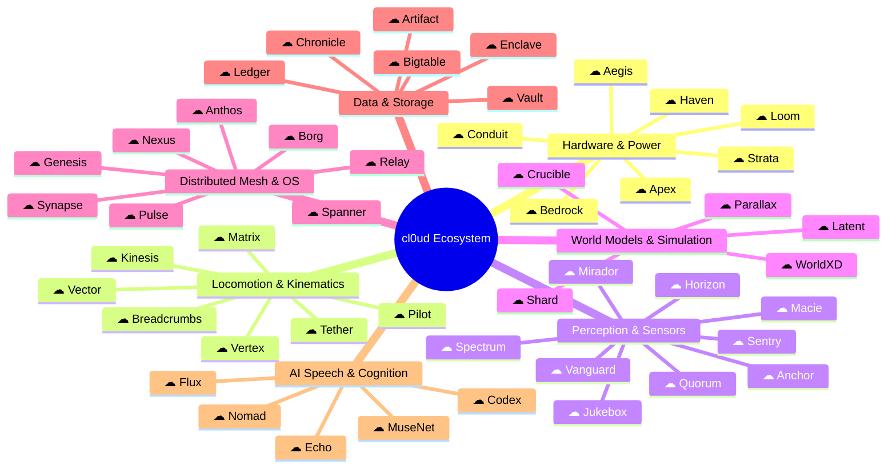

# cl0ud — Subsystem, Product & Infrastructure Catalog (50 Core Modules)

> **System Designation:** Architectural Subsystem Taxonomy & Rhetorical Brand Lockup Standard  
> **Brand Lockup Paradigm:** `[cl0ud Logo]` + `[Subsystem Name]` (Apple-style inline symbol lockup)  
> **Lead Systems Architect:** Ojas Singh ([`@Ojas-sta`](https://github.com/Ojas-sta))  
> **Specification Reference:** [`cl0ud-brand-spec.json`](file:///Users/roopalisingh/Desktop/cl0ud/cl0ud-brand-spec.json)

---

## Executive Overview & The Apple Lockup Paradigm

In the cl0ud engineering architecture, individual subsystems, internal services, products, and infrastructure layers follow the **unified inline glyph lockup model** pioneered by Apple (e.g., `Card`, `Pay`, `Watch`, `Vision`). 

Instead of typing the full text `cl0ud Bedrock`, the official symbol stands in directly:
```
[☁] Bedrock    [☁] Vertex    [☁] Borg    [☁] Breadcrumbs    [☁] Artifact
```

### Visual Lockup Standards
- **Symbol-to-Cap Ratio:** The infinity-cloud symbol height is scaled to exactly **$1.05\times$** the font cap-height.
- **Horizontal Kerning Gap:** Spacing between the rightmost edge of the cloud symbol and the first glyph of the subsystem name is strictly **$0.38\text{--}0.42\times$** cap-height.
- **Baseline Alignment:** The horizontal base stroke of the infinity-cloud symbol anchors along the font baseline.
- **Primary Typeface:** **Outfit** (Semi-Bold 600 / Bold 700) or **Space Grotesk**.
- **Surface Finishes:** High-contrast Monochrome, Electric Cyan, or Prismatic Titanium gradient (matching `Card`).

---

## Index of 50 Subsystems by Architectural Domain



---

## Layer 1: Hardware, Power Topology & Electrical Infrastructure

### 1. `☁ Bedrock`
- **Etymology:** Metaphorical borrowing from foundational geology and AWS Bedrock; represents the immovable base electrical and mechanical foundation upon which all autonomy rests.
- **Technical Function:** Multi-rail isolated power distribution board and DC-DC step-down buck regulation infrastructure. Regulates raw high-voltage battery inputs ($28.8\text{V}$ Unitree Go2 or $14.8\text{V}$ LiPo packs) down to isolated $12\text{V}$, $5\text{V}$, and $3.3\text{V}$ buses with zero ground loop interference.
- **Key Hardware:** Optocoupled buck converters, low-ESR solid aluminum electrolytic capacitors, and LC filtering stages.

### 2. `☁ Conduit`
- **Etymology:** Rhetorical term for a protected channel that conveys essential fluid/current; inspired by AWS and high-voltage transmission architecture.
- **Technical Function:** High-current shielded power harness equipped with inline transient voltage suppression (TVS) diodes, reverse-polarity P-channel MOSFET gates, and dynamic current-shunt telemetry sensors ($100\text{Hz}$ sample rate).

### 3. `☁ Strata`
- **Etymology:** Layered geological formations; represents the physical multi-cell state layers of battery energy storage.
- **Technical Function:** Real-time Lithium-Ion/LiPo battery health analyzer and cell impedance estimator. Computes dynamic Internal Resistance (IR) in $\text{m}\Omega$, Coulomb-counting State of Charge (SoC), and State of Health (SoH) metrics to predict thermal limits before high-torque motor sprints.

### 4. `☁ Haven`
- **Etymology:** A secure harbor or refuge; represents thermal protection and component survival.
- **Technical Function:** Active and passive thermal management supervisor. Monitors thermocouple nodes across motor stator shells, compute exhaust heatsinks (Jetson/Raspberry Pi), and step-down coils, dynamically adjusting PWM fan cooling curves and throttling motor outputs during high ambient heat.

### 5. `☁ Aegis`
- **Etymology:** The mythological divine shield; represents complete electrical defense.
- **Technical Function:** Fast-acting hardware surge and electrostatic discharge (ESD) protection layer. Clamps inductive back-EMF spikes generated during sudden quadruped BLDC motor deceleration ($< 5\text{ns}$ response time) to protect sensitive RealSense camera logic boards and microcontrollers.

### 6. `☁ Loom`
- **Etymology:** The industrial textile machine; symbolizes the intricate, interwoven wiring harness of complex mechatronic systems.
- **Technical Function:** Automated wiring harness CAD routing, pinout matrix mapping, and crimp-connector documentation tool. Enforces color-coded silicone wire standards (18 AWG power, 26 AWG I2C telemetry, twisted-pair CAN bus) across all physical chassis.

### 7. `☁ Apex`
- **Etymology:** The highest peak; represents boundary limiters and dynamic thresholds.
- **Technical Function:** Dynamic peak motor torque and stator current limiter. Intercepts instantaneous actuator demands exceeding $45\text{ N}\cdot\text{m}$, smoothing trajectory pulses through cubic acceleration tapering to prevent motor driver MOSFET thermal breakdown.

---

## Layer 2: Kinematics, Locomotion & Real-Time Motion Control

### 8. `☁ Vertex`
- **Etymology:** Geometric intersection point; inspired by Google Cloud Vertex AI and 3D coordinate mathematics.
- **Technical Function:** Closed-form analytical 6-DOF Inverse Kinematics (IK) and forward kinematics calculation engine. Resolves Cartesian spatial target vectors $(X, Y, Z, \text{Roll}, \text{Pitch}, \text{Yaw})$ into actuator joint angles in $< 1.8\text{ms}$ with zero numerical divergence.

### 9. `☁ Kinesis`
- **Etymology:** From the Greek for movement; represents dynamic cybernetic locomotion.
- **Technical Function:** Dynamic 12-DOF quadruped gait sequencing state machine. Orchestrates active compliance, foot trajectory spline generation, and terrain adaptation across trot, crawl, pronk, and stair-climbing operational modes on the Unitree Go2 platform.

### 10. `☁ Breadcrumbs`
- **Etymology:** Metaphorical trail markers left to find one's way back; represents deterministic topological odometry backtracking.
- **Technical Function:** High-reliability deterministic waypoint navigation and emergency reverse-path backtracking engine. Drops coordinate anchors every $200\text{mm}$ along active patrol routes; if optical sensors suffer blinding or LiDAR drops out, the system deterministically executes kinematic path reversal.

### 11. `☁ Vector`
- **Etymology:** Directional magnitude; fundamental mathematical primitive for physics and spatial engines.
- **Technical Function:** Continuous multi-joint trajectory spline smoother. Minimizes third-order mathematical derivative (jerk / $\text{m/s}^3$) across motor linkages, eliminating mechanical chattering and vibrations in robotic arm linkages and quadruped hip mounts.

### 12. `☁ Matrix`
- **Etymology:** Mathematical array; represents the transformation matrices connecting spatial coordinate systems.
- **Technical Function:** Real-time multi-body Jacobian matrix solver. Computes joint velocity relationships, end-effector singularity detection, and operational force manipulability ellipsoids in real time.

### 13. `☁ Pilot`
- **Etymology:** The autonomous navigator and guiding force.
- **Technical Function:** Exhibition tour guide route planner. Coordinates synchronized kinematic movements (e.g. $180^\circ$ presenter pivots, table-side docking, and elevator threshold crossing) during VIP docent tours.

### 14. `☁ Tether`
- **Etymology:** A safety lifeline connecting an operator to a machine.
- **Technical Function:** Optical and radio frequency fail-safe emergency stop (E-stop) controller. Continuously monitors a cryptographic heartbeat ping; if lost for $> 150\text{ms}$, it trips isolated solid-state relays, cleanly dropping all motor driver power while preserving sensor telemetry.

---

## Layer 3: Perception, Computer Vision & Sensory Integration

### 15. `☁ Horizon`
- **Etymology:** The line where earth meets sky; inspired by panoramic LiDAR view envelopes.
- **Technical Function:** 4D ultra-wide hemispherical LiDAR point cloud clustering and planar floor extraction pipeline. Filters noise points, computes convex obstacles, and isolates ground surface gradients at $20\text{Hz}$.

### 16. `☁ Mirador`
- **Etymology:** Spanish for a scenic watchtower or lookout post.
- **Technical Function:** Intel RealSense D435i stereo depth disparity filter and optical flare suppression pipeline. Eradicates specular reflections from polished makerspace floors and computes spatial obstacle point maps.

### 17. `☁ Anchor`
- **Etymology:** Fixed point of stability and reference.
- **Technical Function:** Optical micro-fiducial localization engine using ArUco and AprilTag 36h11 markers. Provides sub-millimeter positional verification for robotic docking stations, rapid tool caddies, and chemical storage lockers.

### 18. `☁ Jukebox`
- **Etymology:** Acoustic jukebox; borrowing OpenAI Jukebox rhetorical naming.
- **Technical Function:** Directional acoustic perception and sound classification pipeline. Processes 4-microphone beamformed arrays to detect ultrasonic anomalies, dropped metallic tools, motor gearbox gear-chatter, and auditory safety alarms.

### 19. `☁ Macie`
- **Etymology:** Borrowed from AWS Macie (data security & pattern classification); metaphorical classifier for environmental anomalies.
- **Technical Function:** Computer vision liquid hazard and chemical spill classification subsystem. Detects and classifies puddles of water, oil, and soldering flux on workshop floors using surface specular reflectance analysis.

### 20. `☁ Quorum`
- **Etymology:** Minimum voting majority needed for institutional action.
- **Technical Function:** Multi-sensor consensus arbitration engine. Fuses conflicting sensor streams (LiDAR vs. stereo depth vs. ultrasonic) using an Extended Kalman Filter (EKF), casting out anomalous sensor spikes with Chi-squared innovation gating.

### 21. `☁ Vanguard`
- **Etymology:** The foremost division of an advancing army; protective front line.
- **Technical Function:** 360-degree ultrasonic safety buffer supervisor. Monitors multi-directional HC-SR04 / US-100 ultrasonic sensors on mobile bases (e.g. Smart Dustbin and Go2 quadruped), triggering hard interrupts if obstacles breach a $400\text{mm}$ envelope.

### 22. `☁ Sentry`
- **Etymology:** A vigilant guard watching over a station.
- **Technical Function:** Human social proxemics supervisor. Uses 2D skeletal tracking to estimate human approach vectors, commanding robots to decelerate and widen lateral berth when navigating crowded school concourses.

### 23. `☁ Spectrum`
- **Etymology:** The electromagnetic color range.
- **Technical Function:** Ambient lux and spectral lighting analyzer. Balances computer vision exposure curves and synchronizes physical NeoPixel / WS2812 status LED illumination bars to signal operational states.

---

## Layer 4: World Models, Simulation & Artificial Intelligence

### 24. `☁ Latent`
- **Etymology:** Latent embeddings; the hidden compressed representations of AI models.
- **Technical Function:** Latent feature-space visual planning engine powered by Meta's V-JEPA. Predicts the outcome of physical robot arm actions within self-supervised feature embeddings without expensive pixel video decoding.

### 25. `☁ Crucible`
- **Etymology:** A container that withstands intense heat; a severe trial or test.
- **Technical Function:** Massively parallel kinematic stress-testing simulation harness running natively on Apple Silicon Metal Performance Shaders (MPS) unified memory. Runs 10,000 randomized robot perturbation trajectories per second.

### 26. `☁ WorldXD`
- **Etymology:** The flagship cl0ud real-time robotics simulation platform.
- **Technical Function:** End-to-end cyber-physical digital twin simulator coupling JEPA-WMS latent representations with analytical robotics kinematics, real-time WebGL rendering, and Apple Silicon hardware acceleration.

### 27. `☁ Shard`
- **Etymology:** Partitioned database shard; inspired by Google/AWS distributed architecture.
- **Technical Function:** Spatial exhibition floor partitioning subsystem. Splits sprawling exhibition halls and multi-room makerspaces into hierarchical octree bounding zones for optimized navigation and path-finding.

### 28. `☁ Parallax`
- **Etymology:** Apparent displacement of an object viewed from two different lines of sight.
- **Technical Function:** 3D hand tracking and spatial gesture controller. Maps 21 MediaPipe hand keypoints into dynamic 3D WebGL viewport controls and pinch-to-interact triggers.

---

## Layer 5: Distributed Mesh, Communication & Operating System Primitives

### 29. `☁ Borg`
- **Etymology:** The legendary Google cluster management and process scheduling system; represents absolute, deterministic supervisory control.
- **Technical Function:** Autonomous cyber-physical process supervisor and watchdog scheduler. Monitors running ROS 2 nodes, micro-ROS daemons, and Python computer vision pipelines; restarts failed nodes in $< 100\text{ms}$ and enforces deterministic thread priorities.

### 30. `☁ Anthos`
- **Etymology:** Greek for blossom; inspired by Google Cloud Anthos hybrid multi-cloud management.
- **Technical Function:** Hybrid runtime mesh bridging bare-metal microcontroller firmware (Arduino Uno R4 Renesas RA4M1, ESP32) with high-level Linux host compute (Ubuntu ROS 2 Humble) over I2C, SPI, and CycloneDDS.

### 31. `☁ Synapse`
- **Etymology:** Biological neural junction passing electrical impulses.
- **Technical Function:** Ultra-low-latency inter-process communication (IPC) message broker utilizing ZeroMQ and shared POSIX memory. Delivers $< 200\mu\text{s}$ message transfer between perception nodes and motor controllers.

### 32. `☁ Spanner`
- **Etymology:** Inspired by Google Spanner; represents globally synchronized atomic clocks and coordination.
- **Technical Function:** Microsecond-synchronized hardware clock synchronization engine. Synchronizes microcontroller timestamps, camera shutter exposures, and LiDAR packet arrival times using PTP (IEEE 1588) over internal Ethernet buses.

### 33. `☁ Nexus`
- **Etymology:** A central connection point linking multiple channels.
- **Technical Function:** Hardware I2C register map routing table and multiplexer manager. Manages 7-bit and 10-bit address arbitration for motor encoders, current monitors, and environmental sensors over shared buses.

### 34. `☁ Pulse`
- **Etymology:** The rhythmic biological heartbeat of life.
- **Technical Function:** Microcontroller hardware watchdog timer and heartbeat ping orchestrator. Requires bidirectional token handshakes between high-level AI algorithms and low-level motor drivers every $50\text{ms}$.

### 35. `☁ Genesis`
- **Etymology:** The origin or beginning; zero-state reset.
- **Technical Function:** Automated 20-point pre-flight diagnostics and hardware initialization orchestrator. Checks bus voltages, sensor calibration offsets, and motor joint zero-calibrations before releasing mechanical brake locks.

### 36. `☁ Relay`
- **Etymology:** Electrical switch and communications relay post.
- **Technical Function:** Low-power long-range wireless telemetry forwarding station. Bridges ESP32 Wi-Fi/ESP-NOW packets into MQTT web streams for real-time mobile dashboard monitoring.

---

## Layer 6: Data, Telemetry & Storage Systems

### 37. `☁ Bigtable`
- **Etymology:** Inspired by Google Bigtable; high-throughput, sparse, multi-dimensional sorted storage.
- **Technical Function:** High-frequency, in-memory circular ring-buffer telemetry store. Records continuous 100 Hz streams of motor torque, stator temperatures, battery currents, and IMU angular velocities with zero disk I/O bottleneck.

### 38. `☁ Artifact`
- **Etymology:** An object produced by human craftsmanship; inspired by Google Cloud Artifact Registry and Anthropic Artifacts.
- **Technical Function:** Centralized Onshape CAD model, STL/STEP mesh geometry, and 3D print slicing gcode repository. Maintains revision-controlled specifications for guide rail brackets and tool caddies.

### 39. `☁ Chronicle`
- **Etymology:** An exhaustive factual historical record; inspired by Google Cloud Chronicle security telemetry.
- **Technical Function:** Flight data recorder ("black box") telemetry subsystem. Continuously caches the preceding 120 seconds of robot sensor, kinematic, and power data, persisting it permanently to NVMe flash storage upon any emergency trip.

### 40. `☁ Vault`
- **Etymology:** A secure subterranean room for precious assets.
- **Technical Function:** Offline-first secure storage for trained neural network weights (PyTorch `.pt` files), local LLM GGUF models, and high-resolution spatial exhibition skyboxes.

### 41. `☁ Ledger`
- **Etymology:** A book of financial/operational accounts; immutable attribution audit.
- **Technical Function:** Machine-readable engineering contribution and attribution registry (`verified-projects.json`). Programmatically verifies that all student collaborators, school teams, and open-source licenses are credited accurately.

### 42. `☁ Enclave`
- **Etymology:** A distinct, protected territory enclosed within another.
- **Technical Function:** Secure hardware cryptographic credential vault. Protects Wi-Fi network credentials, anti-cheat cryptographic voting signing keys, and administrative API tokens inside isolated microcontroller flash partitions.

---

## Layer 7: Cognitive Intelligence, Spatial Web & Interactive Services

### 43. `☁ Echo`
- **Etymology:** Sound reflection; borrowing Amazon Echo / acoustic reflection concepts.
- **Technical Function:** Offline conversational speech-to-text and local audio synthesis engine. Combines OpenAI Whisper for local microphone transcription with Piper TTS for responsive voice generation without internet connectivity.

### 44. `☁ Codex`
- **Etymology:** An ancient manuscript in book form; inspired by OpenAI Codex.
- **Technical Function:** Local Retrieval-Augmented Generation (RAG) knowledge engine. Embeds the 5.0.0 Master Technical Monograph and DPSI student roster into local vector stores (ChromaDB / Ollama), answering VIP evaluator queries with zero hallucinations.

### 45. `☁ MuseNet`
- **Etymology:** The artistic muse; inspired by OpenAI MuseNet.
- **Technical Function:** Expressive quadruped choreographic gesture generator. Generates friendly, human-like quadruped greeting poses (head tilt, paw wave, friendly bow) to engage exhibition visitors.

### 46. `☁ Nomad`
- **Etymology:** A traveler who moves continuously from place to place.
- **Technical Function:** Single-floor autonomous makerspace courier dispatch service. Accepts bench-to-bench payload delivery requests (hand tools, multimeter, soldering iron) and navigates between marked laboratory workstations.

### 47. `☁ Flux`
- **Etymology:** Continuous flow and chemical change.
- **Technical Function:** Closed-loop automated chemical dosing controller for hydroponic farming. Computes multi-point temperature-compensated pH and electrical conductivity (EC) equations to drive peristaltic pumps.

### 48. `☁ Prism`
- **Etymology:** Optical crystal that separates light into spectral components.
- **Technical Function:** Photorealistic architectural 3D rendering pipeline (Three.js & React Three Fiber). Renders Carrara white satin floor slabs, brushed titanium plinths, and soft directional daylighting for virtual exhibition floor plans.

### 49. `☁ Sentinel`
- **Etymology:** A guard or soldier whose job is to stand and keep watch.
- **Technical Function:** 4-layer client-server anti-cheat voting verification engine. Combines canvas/WebGL device entropy fingerprinting, IP rate-limiting, honeypot fields, and signed ephemeral session tokens to guarantee fair exhibition voting.

### 50. `☁ Orbit`
- **Etymology:** The curved path of a celestial object around a star or planet.
- **Technical Function:** 3D camera orbital navigation and smooth focal transition controller. Powers cinematic camera zooms and transitions between project booths in the DPSI virtual exhibition digital twin.

---

## Visual Branding Specifications: The Apple Lockup Model

To implement these 50 subsystems in digital, physical, and web contexts:

```
+-----------------------------------------------------------------------------+
|                     CL0UD INLINE SUBSYSTEM LOCKUP METRICS                   |
+-----------------------------------------------------------------------------+

            ╭───────╮
        ╭──╯ ╭─────╮ ╰──╮       BBBB                     k
      ╭─╯   │ ╭───╮ │   ╰─╮     B   B  eee   dddd  rr r  k  k
      │  ╭──╯ │   │ ╰──╮  │     BBBB  e   e d   d  r r   k k
      ╰──┴────┴───┴────┴──┴─    B   B eeeee d   d  r     kk
                                BBBB   eeee  dddd  r     k  k
     |←------- Ws --------→|  |←- G -→|←----------- Wt ----------→|
     |←------------------- Total Lockup Width -------------------→|
```

### Typographic Tokens
- **Font:** `Outfit` (Weight: 600 Semi-Bold or 700 Bold)
- **Cap Height ($H$):** Standard baseline $54\text{px}$ (at $64\text{px}$ font size).
- **Symbol Height ($H_s$):** $1.05 \times H \approx 56.7\text{px}$.
- **Optical Gap ($G$):** $0.38 \times H \approx 20.5\text{px}$.
- **Tracking / Letter Spacing:** `-0.02em` (clean, tight, architectural spacing).
- **Asset Vector:** [`assets/logos/cl0ud-lockup-system.svg`](file:///Users/roopalisingh/Desktop/cl0ud/assets/logos/cl0ud-lockup-system.svg).
