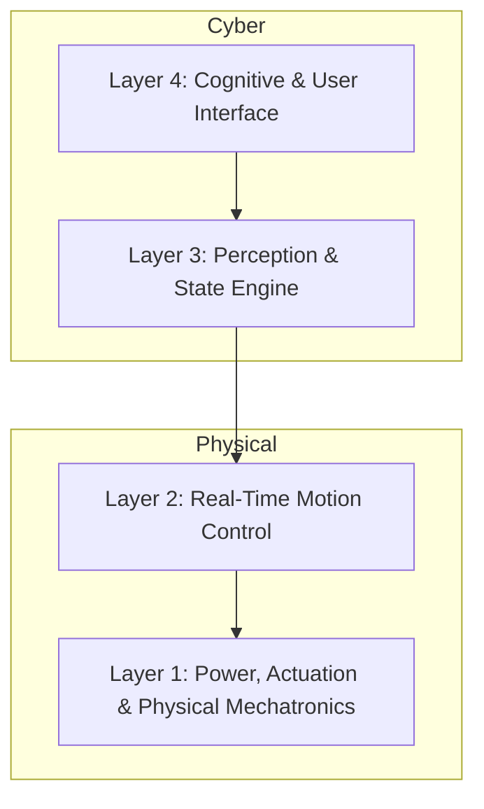

# cl0ud — System Design & Architecture Principles

> **System Designation:** Architectural Principles for Cyber-Physical Systems  
> **Brand Mark:** cl0ud  
> **Lead Architect:** Ojas Singh  
> **Specification Reference:** [`cl0ud-brand-spec.json`](file:///Users/roopalisingh/Desktop/cl0ud/cl0ud-brand-spec.json)

---

## 1. The Cyber-Physical Interface

cl0ud systems operate where abstract software meets tangible physics. We design architectures around four core layers:

### Layer 1: Physical Mechatronics & Power Topology
- **Isolated Power Domains:** High-current motor loads must never share raw power rails with sensitive compute modules (e.g. RealSense, Jetson, Raspberry Pi). Buck regulators with optocouplers or isolated DC-DC converters are mandatory.
- **Inductive Back-EMF Suppression:** Flyback diodes and transient voltage suppression (TVS) diodes are required on all inductive relay and motor lines.
- **Vibration Attenuation:** Optical sensors (stereo cameras, LiDAR) must be mechanically decoupled from chassis harmonic resonance using silicone dampers.

### Layer 2: Real-Time Motion Control
- **Deterministic State Engines:** Finite State Machines (FSMs) dictate all physical motion transitions. No state may transition without explicit sensor acknowledgement.
- **Watchdog Safeguards:** Hardware and software watchdogs ensure motors cut out if a control loop stalls.

### Layer 3: Perception & State Engine
- **Sensor Fusion:** Combine high-rate IMU data with optical odometry and LiDAR scan-matching using Extended Kalman Filters (EKF).
- **Graceful Blindness:** If camera optics are blinded by lighting flare or occlusion, the system defaults to proximity ultrasonic braking.

### Layer 4: Cognitive & User Interface
- **Local-First AI:** Prefer on-device or local network inference (Ollama, Whisper, PyTorch MPS) to eliminate cloud latency and external dependency during critical live demonstrations.
- **Grounded Narration:** Conversational agents are restricted to verified local RAG monographs to eliminate hallucination.
