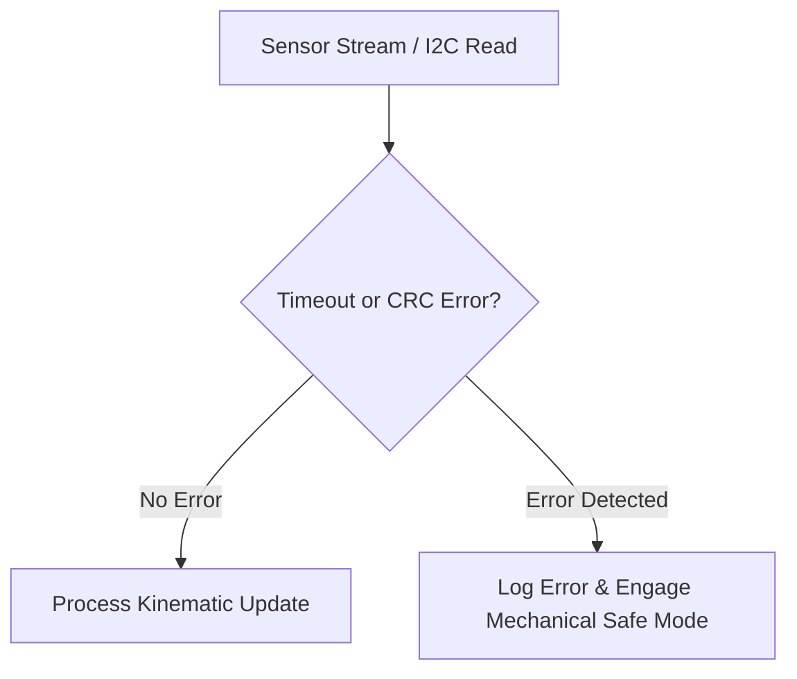

# cl0ud — Engineering Coding Standards

> **System Designation:** Technical Standards — Software & Firmware  
> **Applicable Domains:** C++, Python, TypeScript, Arduino Bare-Metal  
> **Brand Identity:** cl0ud  
> **Specification Reference:** [`cl0ud-brand-spec.json`](file:///Users/roopalisingh/Desktop/cl0ud/cl0ud-brand-spec.json)

---

## 1. High-Level Principles

1. **Deterministic Execution:** No unbounded while loops in physical microcontroller code. Watchdog timers and explicit timeouts are mandatory for all hardware bus transactions (I2C, SPI, UART).
2. **Explicit Typings & Schemas:** Python code must utilize type hints (PEP 484); web code must strictly enforce TypeScript without `any` escapes.
3. **Graceful Degradation:** If depth cameras, LiDAR, or network telemetry fail, physical actuators must immediately decelerate to a fail-safe mechanical resting state.

---

## 2. Microcontroller & C++ Standards (Embedded Robotics)

- **Naming Conventions:**
  - Classes & Structs: `PascalCase` (e.g. `PowerDistributionManager`)
  - Functions & Methods: `camelCase` (e.g. `readBusVoltage()`)
  - Constants & Macros: `ALL_CAPS_SNAKE` (e.g. `MAX_TORQUE_LIMIT_NM`)
  - Register Addresses: Prefixed with `REG_` and hex formatted (e.g. `REG_MOTOR_STATUS 0x2A`)
- **Memory Management:** Zero dynamic allocation (`malloc` or `new`) within periodic robot control loops ($\ge 50\text{Hz}$). Static ring buffers only.
- **Fail-Safe Emergency Stop:** Any communication loss with the host controller exceeding $250\text{ms}$ must trigger an automatic motor torque cutoff.

---

## 3. Python Standards (AI, Simulation & ROS 2)

- **Standard:** Python 3.11+, PEP 8 compliant, formatted with `ruff` or `black`.
- **Type Annotations:** Full type hinting for all public functions and data classes.
- **Apple Silicon Optimization:** Tensor operations must leverage `torch.device("mps")` with explicit CPU fallback and unified memory cache clearing.
- **Logging:** Use Python's built-in `logging` module with structured formats; never leave raw `print()` statements in production services.

---

## 4. Web & 3D Standards (Next.js & React Three Fiber)

- **Framework:** Next.js App Router with TypeScript strictly enabled (`strict: true`).
- **3D Render Loop Efficiency:**
  - Avoid creating geometries or materials inside `useFrame` render callbacks.
  - Dispose unused GPU buffers upon component unmount (`geometry.dispose()`, `material.dispose()`).
- **Security:** Sanitize all incoming user input; implement client and server entropy checks for voting and form endpoints.
