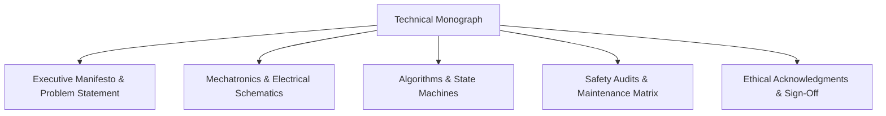

# cl0ud — Technical Monograph Standard

> **System Designation:** Technical Writing & Architectural Monograph Standard  
> **Brand Mark:** cl0ud  
> **Lead Architect:** Ojas Singh  
> **Specification Reference:** [`cl0ud-brand-spec.json`](file:///Users/roopalisingh/Desktop/cl0ud/cl0ud-brand-spec.json)

---

## 1. The Monograph Philosophy

In the cl0ud engineering paradigm, technical documentation is an integral subsystem of equal importance to physical hardware and software code. 

A cl0ud Technical Monograph (such as the *Project CLOUD Rev 5.0.0 Monograph*) provides an exhaustive, authoritative single source of truth for academic judges, engineering peers, and laboratory directors.

---

## 2. Standard Monograph Structure

Every major engineering release must include a `PROJECT.md` or `MONOGRAPH.md` containing the following 10 mandatory sections:

1. **Document Header Block:** Platform base, system designation, operational identities, sensor payloads, document revision (SemVer), and target audience.
2. **Executive Summary & Engineering Manifesto:** The problem genesis, critique of superficial solutions, and multi-metric comparison.
3. **Core Operational Identity & State Machine:** Behavioral modulation, finite state transitions, and proxemics.
4. **Hardware Integration & Mechatronics:** Kinematics, CAD interfaces, stress analysis, material selection, electrical power distribution, and EMI suppression.
5. **Operational Modules:** In-depth technical breakdown of each functional capability (e.g. tool tracking, courier runs, conversational RAG).
6. **Electrical & Communication Topology:** Complete schematic block diagrams, voltage rails, and bus protocols.
7. **Software Architecture & Data Flow:** Component communication (ROS 2 / DDS), message schemas, and API contracts.
8. **Empirical Results & Benchmarks:** Measurable real-world data (latency, torque, battery endurance, tracking error).
9. **Maintenance & Safety Matrix:** Daily, weekly, monthly, and annual maintenance runbooks.
10. **Institutional Sign-Off & Acknowledgments:** Explicit credits for student peers, faculty mentors, and upstream open-source projects.
