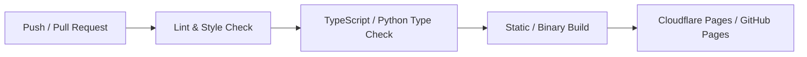

# cl0ud — Continuous Integration & Deployment Standards

> **System Designation:** Software & Web CI/CD Pipelines  
> **Brand Mark:** cl0ud  
> **Specification Reference:** [`cl0ud-brand-spec.json`](file:///Users/roopalisingh/Desktop/cl0ud/cl0ud-brand-spec.json)

---

## 1. Automation Architecture

All cl0ud web and software repositories maintain automated GitHub Actions workflows to guarantee code quality, type safety, and seamless deployments.

---

## 2. CI Pipeline Requirements

Every pull request must automatically pass three mandatory checks before merging into `main`:
1. **Linter & Formatter:** ESLint / Ruff pass with zero errors.
2. **Type Safety:** `tsc --noEmit` (TypeScript) or `mypy` (Python) pass cleanly.
3. **Build Integrity:** `npm run build` or build script generates production artifacts without missing module errors.

---

## 3. Deployment Configuration (Cloudflare Pages)

For web platforms (e.g. `dpsi-exhibition`):
- Deployment is triggered strictly upon merge into `main`.
- Static site artifacts are exported to `out/` and deployed directly to Cloudflare edge nodes.
- Secrets (`CLOUDFLARE_API_TOKEN`, `CLOUDFLARE_ACCOUNT_ID`) are stored strictly within GitHub Repository Secrets.
