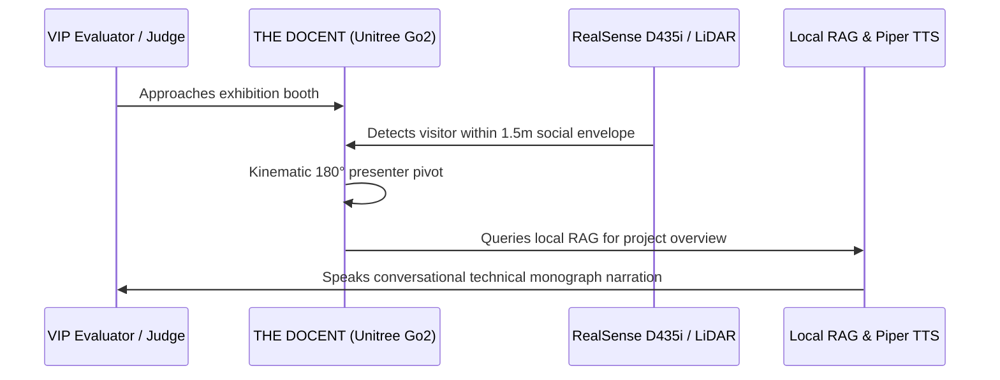

# Exhibition Project Case Study — Project CLOUD

[](https://www.unitree.com/)
[](https://github.com/Ojas-sta/cl0ud-brand-engineering)
[](https://github.com/Ojas-sta)

> **Exhibition Context:** DPSI Tech & Innovation Exhibition 2026  
> **System Designation:** CLOUD (Cognitive Laboratory Operations & Utility Dispatcher)  
> **Dual Personas:** ARGUS (Makerspace Steward) & THE DOCENT (VIP Tour Guide)  
> **Source Repository:** [`https://github.com/Ojas-sta/Cloud_DPSI-EXPO26`](https://github.com/Ojas-sta/Cloud_DPSI-EXPO26)

---

## 1. Project Background
Project CLOUD was engineered for the DPS Indirapuram Annual Exhibition as both a physical demonstration of high-level quadruped kinematics and an operational makerspace utility tool.



---

## 2. Key Engineering Highlights
- **Custom Back-Load Guide Rail Mounting:** Vibration-dampened mechanical interface mounted with 8x M4 guide rail screws into the Go2 structural spine.
- **Dual-Bay Utility Caddy:** PETG rapid-prototyped tool holder with magnetic retention.
- **Isolated Power Distribution:** Step-down buck regulation with TVS surge protection.

---

## 3. Exhibition Attribution Plinth
Mounted directly to the robot chassis spine:
```text
SYSTEMS ARCHITECTURE: Powered by cl0ud
CO-ENGINEERED BY:     Ojas Singh
HOST TEAM:            DPSI Student Robotics Team
ACADEMIC LAB:         Advanced Prototyping Center, DPS Indirapuram
```
