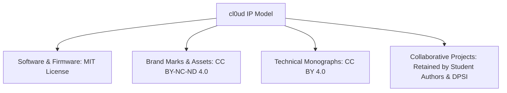

# cl0ud — Intellectual Property Framework

> **System Designation:** Legal Architecture — IP Rights & Licensing  
> **Brand Mark:** cl0ud  
> **Specification Reference:** [`cl0ud-brand-spec.json`](file:///Users/roopalisingh/Desktop/cl0ud/cl0ud-brand-spec.json)

---

## 1. Ownership Framework

The cl0ud ecosystem maintains a strict multi-tier intellectual property model designed to protect individual builders while encouraging open-source hardware collaboration.

---

## 2. Licensing Breakdown

### 1. Software Code, Firmware & Tooling (MIT License)
All reusable source code, Python scripts, Arduino libraries, and CI/CD actions authored by cl0ud are licensed under the permissive **MIT License**. Anyone is free to use, copy, modify, merge, and distribute the code, provided the original copyright notice is retained.

### 2. Brand Marks, Logos & Badges (CC BY-NC-ND 4.0)
The visual marks, logos, vector glyphs, and brand badges are licensed under the **Creative Commons Attribution-NonCommercial-NoDerivatives 4.0 International License**. You may share and display them to attribute verified engineering work, but you may not alter them or use them for commercial sale.

### 3. Technical Monographs & Documentation (CC BY 4.0)
The architectural monographs, wiring schematics, and engineering guides are licensed under **Creative Commons Attribution 4.0 International (CC BY 4.0)**, encouraging academic citation and educational reproduction with proper attribution.

---

## 3. Third-Party Trademarks & Open-Source Upstream

- **Unitree Robotics®** is a registered trademark of Hangzhou Yushu Technology Co., Ltd.
- **Intel® RealSense™** is a trademark of Intel Corporation.
- **Arduino®** is a registered trademark of Arduino AG.
- **Meta® / JEPA** are trademarks and research architectures of Meta Platforms, Inc.
- **Three.js, React, Next.js, and ROS 2** belong to their respective copyright holders.

cl0ud claims no affiliation with, endorsement by, or ownership of these upstream platforms.
