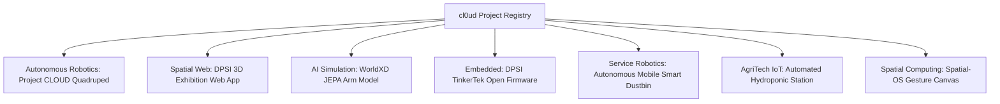

# cl0ud — Engineering Project Registry & Directory

> **System Designation:** Project Index & Taxonomy Guide  
> **Registry Source:** [`verified-projects.json`](file:///Users/roopalisingh/Desktop/cl0ud/projects/verified-projects.json)  
> **Lead Systems Architect:** Ojas Singh ([`@Ojas-sta`](https://github.com/Ojas-sta))  
> **Brand Mark:** cl0ud  
> **Specification Reference:** [`cl0ud-brand-spec.json`](file:///Users/roopalisingh/Desktop/cl0ud/cl0ud-brand-spec.json)

---

## 1. Project Directory Overview

This directory acts as the **central verified registry** for all engineering initiatives associated with **cl0ud** and **Ojas Singh**. 

Every project is categorized according to its technical domain and tagged with an exact attribution tier to maintain absolute intellectual property transparency between cl0ud internal research and external institutional collaborations.

---

## 2. Verified Active Projects Summary Table

| ID | Project Name | Domain / Stack | cl0ud Role | Primary Authors / Ownership | Status |
| :--- | :--- | :--- | :--- | :--- | :--- |
| **`PRJ-001`** | **Project CLOUD (ARGUS / Docent)** | Unitree Go2, ROS 2, RealSense, Ollama | *Powered by* | DPSI Student Robotics Team / Ojas Singh | Field Deployed |
| **`PRJ-002`** | **DPSI 3D Virtual Exhibition** | Next.js, Three.js, R3F, Cloudflare | *Powered by* | DPS Indirapuram / Ojas Singh | Active |
| **`PRJ-003`** | **WorldXD JEPA Simulation** | PyTorch MPS, Meta JEPA, Inverse Kinematics | *Created by* | cl0ud (Ojas Singh) | Active |
| **`PRJ-004`** | **DPSI TinkerTek Open Firmware** | Arduino Uno R4 WiFi, C++, I2C Bus | *Co-engineered by* | DPSI / School For Schools / Ojas Singh | Active |
| **`PRJ-005`** | **Autonomous Smart Dustbin** | OpenCV, Tracking, Differential Drive, ESP32 | *Technical assistance by* | Student Innovation Team (Adv: Ojas Singh) | In Development |
| **`PRJ-006`** | **Automated Hydroponics IoT** | ESP32, pH/EC Probes, MQTT, Dosing Pumps | *Technical assistance by* | Hydroponics Sustainability Team (Adv: Ojas Singh) | In Development |
| **`PRJ-007`** | **Spatial-OS & Vision-Track** | MediaPipe Hands, WebGL, Parallax Canvas | *Created by* | cl0ud (Ojas Singh) | Active |

---

## 3. Onboarding a New Project

To register a new project in the cl0ud ecosystem:
1. Duplicate the template directory: [`projects/project-template/`](file:///Users/roopalisingh/Desktop/cl0ud/projects/project-template/).
2. Fill out the project `metadata.json` and `README.md`.
3. Add the project entry into [`verified-projects.json`](file:///Users/roopalisingh/Desktop/cl0ud/projects/verified-projects.json).
4. Run [`tools/validation/validate-brand-spec.py`](file:///Users/roopalisingh/Desktop/cl0ud/tools/validation/validate-brand-spec.py) to ensure all fields and attribution rules pass validation.
