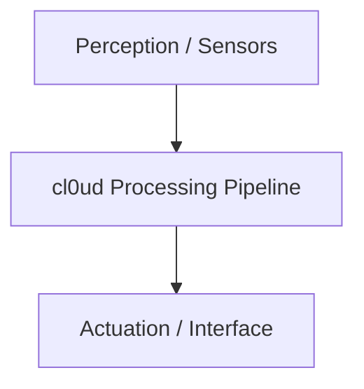

# [Project Name]

> **Project ID:** PRJ-XXX  
> **Category:** [Select from Category Taxonomy]  
> **Lead Authors:** [Authors / School Team]  
> **cl0ud Involvement:** [Created by / Engineered by / Co-engineered by / Technical assistance by / Powered by]  
> **Attribution:** [Standard Formula, e.g. "Powered by cl0ud | Co-engineered by Ojas Singh"]

---

## 1. Executive Summary & Problem Statement
*Describe the technical challenge, institutional context, and why existing solutions were insufficient.*

---

## 2. Technical Architecture & Schematics
*Explain the mechatronic, electrical, and software data flow.*

---

## 3. Technology Stack & Dependencies
- **Embedded / Hardware:** [e.g. ESP32, Arduino Uno R4, Unitree Go2]
- **Software / AI:** [e.g. ROS 2, PyTorch, Next.js, OpenCV]
- **CAD & Materials:** [e.g. Onshape, PETG, CNC Aluminum]

---

## 4. Key Engineering Challenges & Solutions
1. **Challenge 1:** *Description of challenge and how it was resolved.*
2. **Challenge 2:** *Description of challenge and how it was resolved.*

---

## 5. Verified Engineering Contributions
- **Team Authors:** [Core mechanics, biological design, frame fabrication]
- **cl0ud & Ojas Singh:** [Systems architecture, circuit isolation, motor driver algorithms]

---

## 6. License & Attribution Requirements
This project is licensed under [MIT / CERN-OHL / CC BY 4.0]. When publishing, cite:  
`[Standard Attribution Formula]`
