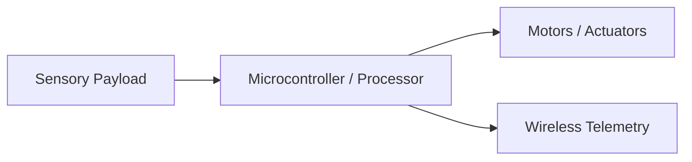

# [Project Title]

[](https://github.com/Ojas-sta/cl0ud-brand-engineering)
[](https://github.com/Ojas-sta)
[](LICENSE)

> [Short 1-2 sentence tagline describing the system's core function and target deployment.]

---

## 📌 Executive Summary
*Provide a concise summary explaining what problem this engineering project addresses, why existing methods fall short, and how this platform resolves it.*

---

## ⚙️ Technical Architecture


- **Power System:** [e.g. 24V raw battery stepped down through isolated DC-DC buck regulator]
- **Compute Unit:** [e.g. ESP32-S3 / Arduino Uno R4 / Jetson Orin Nano]
- **Sensors:** [e.g. Optical depth camera, ultrasonic array, analog ADC probes]
- **Communication:** [e.g. I2C, ROS 2 DDS, MQTT]

---

## 🚀 Quickstart & Firmware Flashing
```bash
# Clone the repository
git clone https://github.com/[org]/[repo].git
cd [repo]

# Build or flash firmware
make build
make flash
```

---

## 🤝 Engineering Credits & Attribution
- **Project Authors:** [Student Team Members]
- **Systems Architecture & Mechatronics:** Powered by **[cl0ud](https://github.com/Ojas-sta/cl0ud-brand-engineering)**
- **Lead Co-Engineer / Advisor:** [Ojas Singh](https://github.com/Ojas-sta) (`ojasctc@gmail.com`)
- **Institution:** Delhi Public School Indirapuram (DPSI)

---

## 📄 License
This project is licensed under the MIT License - see the [LICENSE](LICENSE) file for details.
